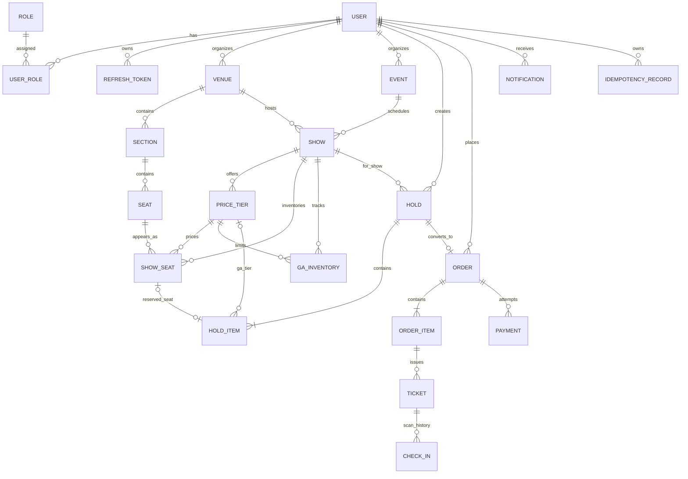
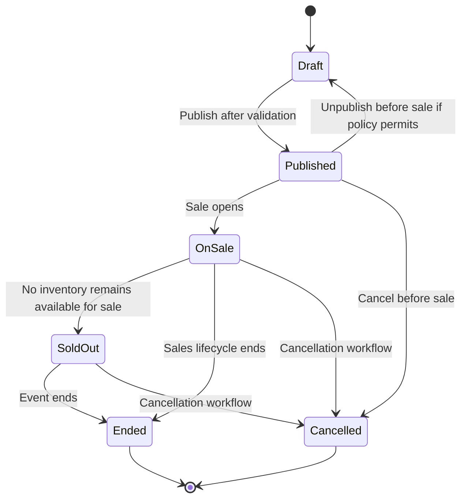
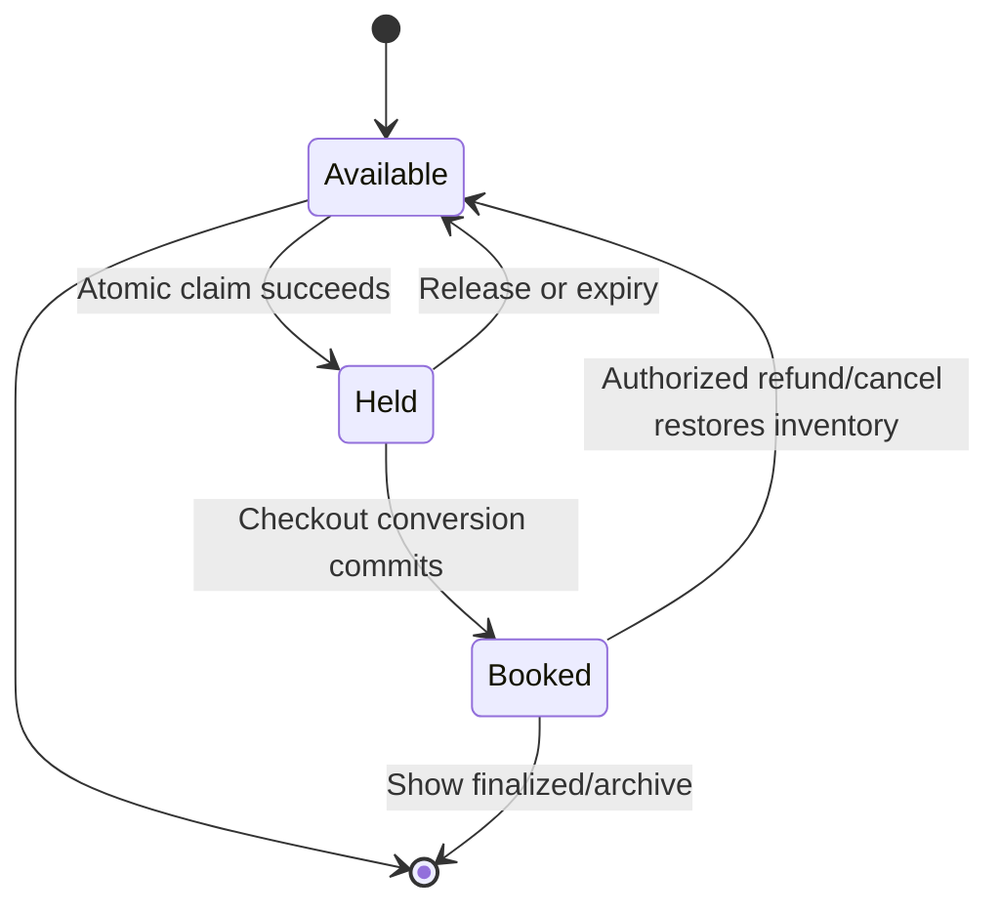
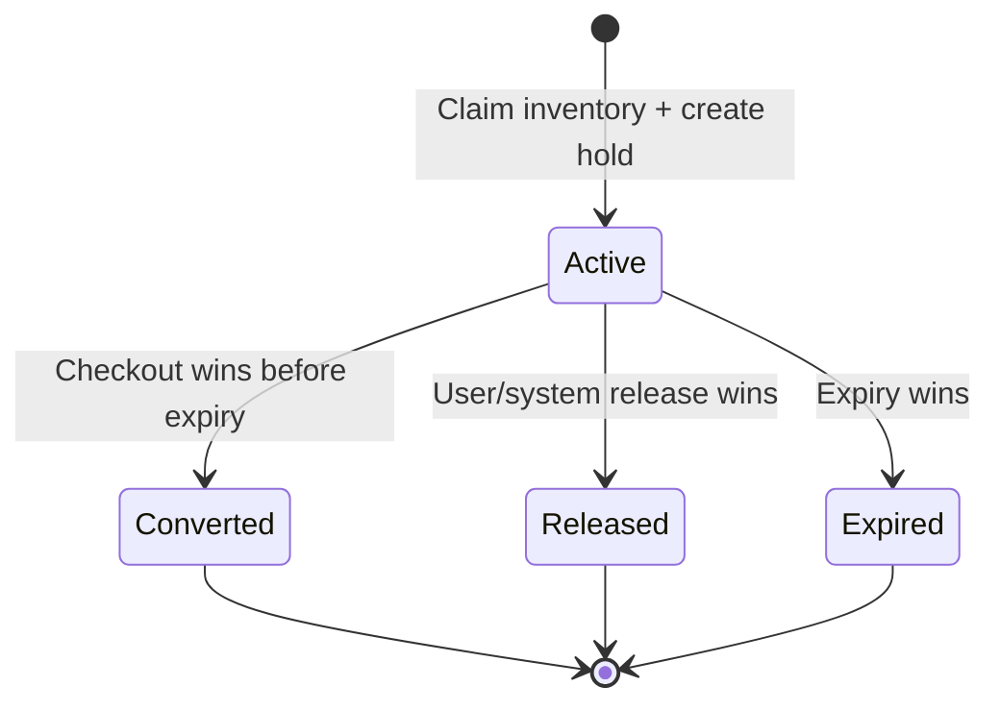
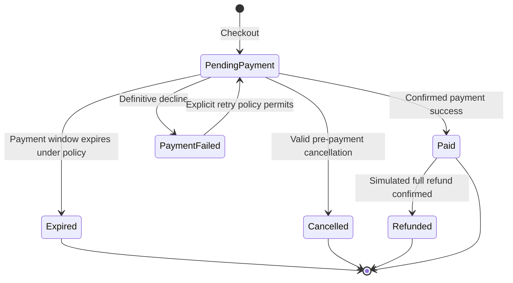
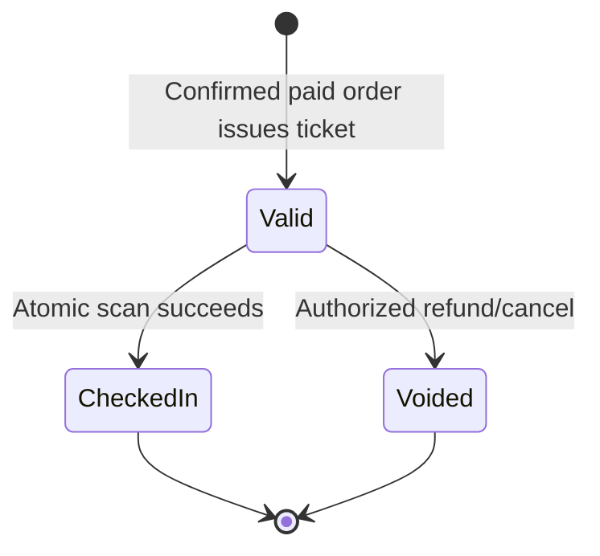
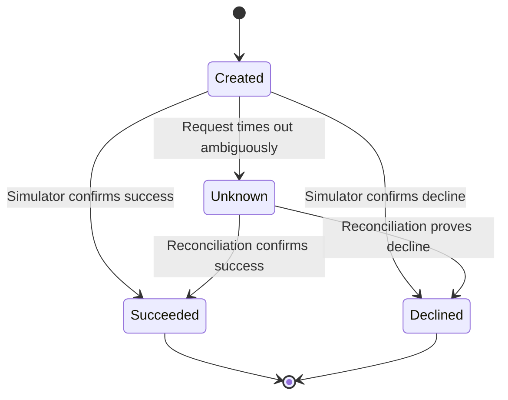
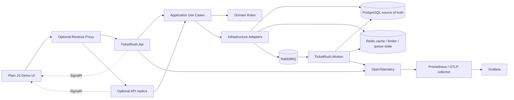
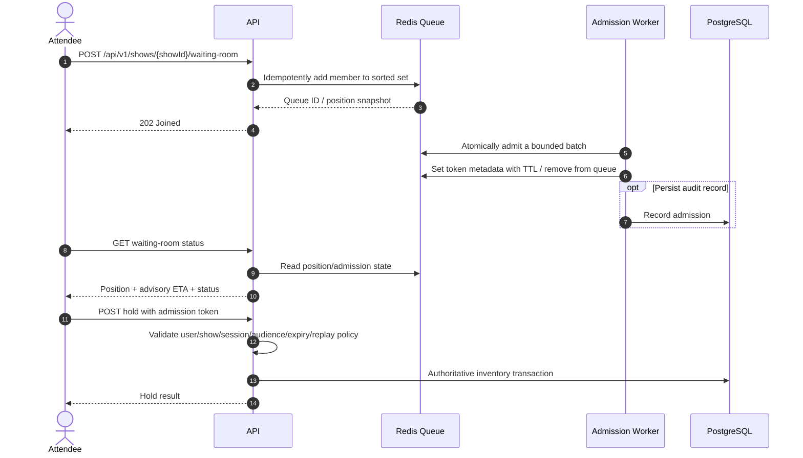

# TicketRush — Full Backend Project Plan (Parts A–H)

**Version:** 1.1 · **Plan date:** 2026-10-29 · **Status:** Revised planning baseline; no application code yet.

> **Source of truth:** This expands the user's TicketRush planning brief. If repository state conflicts with this plan, stop and report the conflict. Do not silently change either. The learner is the decision-maker; AI is advisory.

## How to use this document

1. Read the whole document before changing the repository.
2. Keep `AGENTS.md`, `PROJECT_STATE.md`, and `WORK_LOG.md` updated.
3. Execute exactly one approved task at a time. Stop after its verification and wait for the user to say `done` / `next` / approve the next task.
4. Before coding, explain in Egyptian Arabic what the task does, why it exists, how it can fail, where it fits, the files to touch, and acceptance criteria.
5. AI may write code, but must explain the diff, assumptions, transaction/security boundaries, and tests. The learner must run verification and understand the outcome.
6. Every task ends with actual verification, a work-log entry, and one conventional commit. Compiling alone is not enough.
7. Never claim production readiness, compliance, millions of users, performance gains, or capacity without an experiment report stating the environment and workload.
8. Teaching and project documentation: Egyptian Arabic, technical terms remain English. Code, SQL, config, comments, commit messages, identifiers and Mermaid labels: English only. Never put Arabic in code/comments.
9. Public-repo hygiene starts on day one: never commit real secrets, personal data, access tokens, production dumps, or generated credentials. Use placeholders in `.env.example`, keep `.gitignore` current, and run a secret scan before each public push.
10. Do not generate application code from this plan alone. First create working agreements; start `D0-01` only after the user explicitly starts implementation.

## Confirmed decisions

| Decision | Choice | Boundary |
|---|---|---|
| Runtime | .NET 10 LTS | Check the latest supported patch at project start. |
| API | ASP.NET Core Web API | Modular monolith; not default microservices. |
| Data | PostgreSQL | Source of truth; EF Core default, Dapper only for measured hot paths. |
| Holds initially | PostgreSQL only | Redis hold prototype is a later experiment, not source of truth. |
| Redis | Added experimentally | Cache, distributed limiter, waiting room, optional SignalR backplane only in planned stages. |
| Async | RabbitMQ + Worker host | Outbox/inbox, bounded retries, DLQ. |
| Realtime | SignalR | Single instance first; backplane only with measured multi-instance need. |
| Demo UI | Plain HTML/CSS/JavaScript | Thin UI; no frontend-learning detour. |
| Local run | Docker Compose first | Cloud is optional after local reproducibility; no spending without approval. |
| Auth | JWT access + rotating refresh tokens | Store refresh-token hashes; test rotation and reuse handling. |
| Workflow | Solo developer + AI agents + GitHub Issues/PR-like process | Real review discipline, no pretend team. |
| Schedule | 12 weeks: 10 planned weeks + 2 explicit buffer weeks, about 60 hours/week | Week-3 checkpoint; a stage overrun by 50% triggers re-planning. |
| Scope | About 60 business HTTP API endpoints; hub/health/metrics are operational surfaces, not counted | CRUD scaffolded, deep learning on 15–20 H endpoints. |

## Risks and scope corrections

1. Mastering every requested technology deeply in 8–10 weeks is unrealistic. A broad portfolio prototype is possible with AI; the cut line below is essential.
2. The naive booking implementation is a controlled local/test experiment only. Disable it from normal demo and never expose it publicly.
3. Correctness is not an optimization: DB constraints and transaction boundaries protect inventory. Cache, Redis TTL, SignalR, and waiting-room tokens are never the final authority over inventory.
4. A cache can show stale availability. Hold creation must execute an authoritative DB operation.
5. PostgreSQL and Redis do not share an atomic transaction. Redis hold experiments must test expiry, eviction, restart and process crashes; PostgreSQL remains the guard.
6. Payment timeout is ambiguous, not necessarily a decline. Persist `Unknown` and reconcile before issuing tickets.
7. Transactional outbox improves recoverability but does not imply exactly-once delivery; duplicates must be safe.
8. The roughly 60-endpoint catalog is breadth, not proof of quality. CRUD still needs validation, authorization and tests.
9. Local k6 results do not prove production or internet-scale capacity. State host, VUs/arrival model, dataset, duration, versions and limits beside every number.
10. .NET 10 is the chosen LTS. Verify Microsoft's current support policy and latest patch at install time: https://dotnet.microsoft.com/en-us/platform/support/policy .

---

# Part A — Domain and Data

## A1. Bounded contexts / modules

A bounded context is a boundary around a vocabulary and its rules. These are modules in one codebase, not microservices.

| Module | Owns / rules | Not responsible for |
|---|---|---|
| Identity | Users, roles, password hashing, refresh-token rotation/reuse | Inventory |
| Venue Management | Venues, sections, seats, layout validation | A particular show's availability |
| Event Catalog | Events, shows, tiers, lifecycle, search | Final booking correctness |
| Inventory | Per-show seat rows, GA counters, atomic claims/releases | Payment orchestration |
| Booking & Orders | Holds/items, order/item snapshots, idempotency | Real payment processing |
| Payment Simulator | Success/decline/unknown outcomes, reconciliation | Card data or real funds |
| Ticketing & Entry | QR payloads, ticket issuance, single-use check-in | Ticket resale marketplace |
| Waiting Room | Queue order, admission/token policy | Inventory authority |
| Notifications | In-app notification records, simulated delivery | Real email delivery |
| Operations & Audit | Audit records, flags, DLQ/replay | Hidden business rules in controllers |
| Observability | Logs, metrics, traces, dashboards, experiment artifacts | Business state mutation |

### Dependency direction

- `Domain`: business types and invariants; no outer-project dependency.
- `Application`: use cases, interfaces/ports, DTOs, validation and orchestration; depends on `Domain` only.
- `Infrastructure`: implements persistence, Redis, RabbitMQ, token/hash providers and adapters; depends on `Domain` + `Application`.
- `Api` and `Worker`: composition roots; depend on `Application` and `Infrastructure` for dependency injection.
- UI accesses API only. Modules must not reach into another module's private DbContext/repository arbitrarily; use explicit application interfaces/read models.

## A2. Domain vocabulary

- **Venue:** physical location and reusable layout.
- **Seat:** physical place in a venue, not inherently booked.
- **Show:** one scheduled occurrence of an event with its own inventory.
- **ShowSeat:** one physical seat's state for one show (`Available/Held/Booked`).
- **GA (general admission):** inventory sold as a counter per show/tier rather than a named seat.
- **Hold:** temporary claim with server-generated expiry.
- **Order:** commercial record created from a hold, with stable price snapshots.
- **Payment attempt:** simulated success, definitive decline or ambiguous timeout.
- **Idempotency key:** client token for retrying one logical command without repeating its side effect.
- **Outbox message:** durable event intent stored in the same DB transaction as the business change.
- **Inbox message:** record that a consumer has processed a message ID.

## A3. Entity and attribute catalogue

Use UUIDs for externally addressed IDs unless an ADR justifies otherwise. Use UTC instants (`timestamptz`), integer minor units for money, and an explicit currency allowlist. Never use floating point for money. These are logical attributes; refine names/types before migrations.

### Identity

| Entity | Key attributes | Constraints / notes |
|---|---|---|
| `User` | `Id`, `EmailNormalized`, `DisplayName`, `PasswordHash`, `IsActive`, `CreatedAt`, `UpdatedAt` | Unique normalized email; never store plaintext password. |
| `Role` | `Id`, `Name` | Unique name; `Attendee`, `Organizer`, `Admin`. |
| `UserRole` | `UserId`, `RoleId`, `AssignedAt` | Composite PK `(UserId, RoleId)`. |
| `RefreshToken` | `Id`, `UserId`, `TokenHash`, `FamilyId`, `CreatedAt`, `ExpiresAt`, `RevokedAt`, `ReplacedByTokenId`, `ReuseDetectedAt`, optional `CreatedByIpHash` | Store only hash; unique hash; rotation revokes prior token. Minimize retained IP data. |

### Venue and catalog

| Entity | Key attributes | Constraints / notes |
|---|---|---|
| `Venue` | `Id`, `OrganizerId`, `Name`, `City`, `AddressText`, `TimezoneId`, `IsArchived`, timestamps | Organizer ownership; historical venue references prevent physical deletion. |
| `Section` | `Id`, `VenueId`, `Code`, `Name`, `SortOrder`, `Capacity`, `SectionType` | Unique `(VenueId, Code)`. GA inventory remains tier-based. |
| `Seat` | `Id`, `VenueId`, `SectionId`, `RowLabel`, `SeatNumber`, `DisplayLabel`, `IsAccessible`, `IsActive` | Unique `(SectionId, RowLabel, SeatNumber)`. |
| `Event` | `Id`, `OrganizerId`, `Title`, `Slug`, `Description`, `Category`, `Status`, timestamps, `PublishedAt`, `CancelledAt` | Unique slug (or scoped slug); catalog concept, not a date-specific performance. |
| `Show` | `Id`, `EventId`, `VenueId`, `StartsAt`, `DoorsOpenAt`, `OnSaleAt`, `SalesCloseAt`, `Status`, `Currency`, timestamps | Time values are UTC instants; validate lifecycle and currency. Decide venue-layout snapshot before V0; later venue edits must not silently mutate generated show inventory. |
| `PriceTier` | `Id`, `ShowId`, `Name`, `Code`, `PriceMinor`, `Currency`, `SalesLimit`, `IsActive`, `SortOrder` | Unique `(ShowId, Code)`; nonnegative price; one currency per show/order in V0. |

### Inventory and booking

| Entity | Key attributes | Constraints / notes |
|---|---|---|
| `ShowSeat` | `Id`, `ShowId`, `SeatId`, `PriceTierId`, `Status`, nullable `HoldId`, nullable `OrderItemId`, `Version`, `UpdatedAt` | Unique `(ShowId, SeatId)`; `Available/Held/Booked`; hold/order links valid for matching status. Application-managed `Version` is more portable than relying on PostgreSQL `xmin`. |
| `GaInventory` | `Id`, `ShowId`, `PriceTierId`, `Capacity`, `Remaining`, `Version`, `UpdatedAt` | Unique `(ShowId, PriceTierId)`; checks `0 <= Remaining <= Capacity`; atomic decrement/release. |
| `Hold` | `Id`, `UserId`, `ShowId`, `Status`, `CreatedAt`, `ExpiresAt`, `ReleasedAt`, `ConvertedAt`, nullable `AdmissionId` | One owner; `ExpiresAt > CreatedAt`; active means `Status=Active AND ExpiresAt > authoritative_now`. |
| `HoldItem` | `Id`, `HoldId`, `InventoryType`, nullable `ShowSeatId`, nullable `PriceTierId`, `Quantity`, `UnitPriceMinor`, `Currency` | Exactly one of seat/tier reference; seat quantity 1, GA quantity > 0; price snapshot captured at hold time. |
| `Order` | `Id`, `UserId`, `ShowId`, `HoldId`, `Status`, `SubtotalMinor`, `FeesMinor`, `TotalMinor`, `Currency`, timestamps, `PaidAt`, `ExpiresAt`, `CancelledAt`, `RefundedAt` | Unique `HoldId`; server-calculated total; total = subtotal + fees under explicit rule. |
| `OrderItem` | `Id`, `OrderId`, `InventoryType`, nullable `ShowSeatId`, nullable `PriceTierId`, `Quantity`, `UnitPriceMinor`, `LineTotalMinor`, `Currency` | Immutable price snapshot after creation; define GA as one quantity line and issue individual ticket rows. |
| `IdempotencyRecord` | `Id`, `UserId`, `Scope`, `Key`, `RequestHash`, `Status`, `ResponseStatus`, `ResponseBodyJson`, `CreatedAt`, `ExpiresAt`, `CompletedAt` | Unique `(UserId, Scope, Key)`; same key/same hash replays; same key/different hash returns 409. Document retention. |

### Payment, ticketing, communications and operations

| Entity | Key attributes | Constraints / notes |
|---|---|---|
| `Payment` | `Id`, `OrderId`, `AttemptNumber`, `IdempotencyKey`, `Status`, `Scenario`, `ProviderReference`, `AmountMinor`, `Currency`, `CreatedAt`, `CompletedAt`, `LastReconciledAt` | Unique `(OrderId, AttemptNumber)` and scoped key; simulator only; no card data. `Unknown` is distinct from decline. |
| `Ticket` | `Id`, `OrderItemId`, `ShowId`, `UserId`, `TicketCode`, `QrPayloadVersion`, `Status`, `IssuedAt`, `VoidedAt` | Unique ticket code; `Valid/CheckedIn/Voided`; QR carries opaque ID/signed token, not PII; GA issues one ticket row per entry. |
| `CheckIn` | `Id`, `TicketId`, `GateId`, `ScannedByUserId`, `ScannedAt`, `Outcome` | Enforce one successful check-in per ticket with conditional/partial unique index or atomic ticket update. Failed scan history may be separate. |
| `Notification` | `Id`, `UserId`, `Type`, `Title`, `Body`, `Status`, `CreatedAt`, `ReadAt`, `RelatedEntityType`, `RelatedEntityId` | In-app and simulated delivery only. |
| `AuditLog` | `Id`, nullable `ActorUserId`, `Action`, `EntityType`, `EntityId`, `OccurredAt`, `CorrelationId`, `MetadataJson` | Append-only at app layer; redact secrets and cap metadata size. |
| `OutboxMessage` | `Id`, `OccurredAt`, `Type`, `PayloadJson`, `CorrelationId`, `Status`, `AttemptCount`, `NextAttemptAt`, `PublishedAt`, `LastErrorCode` | Same transaction as business change; safely claim batches; bounded retry and retention. |
| `InboxMessage` | `ConsumerName`, `MessageId`, `ProcessedAt`, `Outcome` | Composite PK `(ConsumerName, MessageId)`; durable side effect and inbox record must coordinate transactionally. |
| `WaitingRoomAdmission` (optional DB audit) | `Id`, `ShowId`, `UserId`, `QueueJoinId`, `TokenHash`, `IssuedAt`, `ExpiresAt`, `ConsumedAt`, `RevokedAt` | Redis owns ephemeral queue state; decide whether each token validation needs DB lookup or a signed stateless token. Don't accidentally make every admitted request DB-heavy. |
| `FeatureFlag` or config | `Key`, `Enabled`, `UpdatedAt`, `UpdatedBy` | Start with config; if persisted, protect/admin-audit changes. Don't build a flag platform. |

### Money and time rules

- Use integer minor units for `PriceMinor`, `TotalMinor`, `FeesMinor`, `LineTotalMinor`; verify max values.
- Explicit currency allowlist, e.g. `EGP`, `USD`, `EUR`; no currency conversion. The show/tier/order currency must match.
- Use `timestamptz` and UTC on server; UI converts to venue timezone.
- Choose enum storage deliberately (stable strings readable but need validation; integers compact but opaque); record in ADR and never silently reorder stored integers.
- EF Core is default. Dapper is allowed only after a query/hot path is measured and must still have tests.

## A4. Conceptual ERD (Mermaid)



This is conceptual and omits operational tables. The database cannot express every cross-row rule: use unique/check constraints, transactions and integration tests as detailed below.

## A5. State machines

### Event lifecycle



Policy: `SoldOut` may be computed rather than persisted; if persisted, decide whether released inventory returns it to `OnSale`. `Cancelled` and `Ended` must not move backward due to a background job.

### ShowSeat lifecycle



A stale seat-map cache never makes a seat sellable. Expiry and checkout serialize through authoritative DB operations.

### Hold lifecycle



Only `Active` with `ExpiresAt > authoritative_now` may convert. The sweeper handles cleanup; the checkout path checks expiry itself.

### Order lifecycle



Default: no partial refund. A payment timeout alone must not set `PaymentFailed`; it becomes `Unknown` at the payment-attempt level until reconciliation. Treat paid-order cancellation as a refund flow, not an unexplained second transition.

### Ticket lifecycle



`CheckedIn` cannot return to `Valid`. Repeat scans fail with `AlreadyCheckedIn`.

### Payment attempt lifecycle



Use deterministic local/test scenarios; forceable outcomes must not be exposed in a real/public deployment.

## A6. Invariants and enforcement map

| ID | Invariant | Primary enforcement | Test / behavior |
|---|---|---|---|
| INV-01 | One inventory row per seat per show | Unique `(ShowId, SeatId)` | Duplicate generation fails or is idempotent. |
| INV-02 | At most one active claim per show seat | Atomic conditional update `Status='Available'` plus row-count check | Two concurrent claims: one wins, loser gets 409. |
| INV-03 | A seat cannot be booked by two orders | Transactional `ShowSeat` ownership/status transition + uniqueness where modeled | Invariant checker and concurrent integration test. |
| INV-04 | GA Remaining never negative | `CHECK Remaining >= 0` + atomic decrement guarded by `Remaining >= quantity` | Demand exceeds capacity; zero negative counts. |
| INV-05 | GA Remaining never above Capacity | `CHECK Remaining <= Capacity`; release only on winning transition | Duplicate release test. |
| INV-06 | Hold has one owner and expiry | Non-null FK/expiry + `ExpiresAt > CreatedAt` | Derive owner from JWT; never trust request user ID. |
| INV-07 | Hold converted/released/expired at most once | Conditional state change in transaction | Checkout-vs-expiry race. |
| INV-08 | One order per hold | Unique `Order.HoldId` | Concurrent checkout. |
| INV-09 | Same idempotency key returns same logical result | Unique `(UserId, Scope, Key)` + stored result | Same-key replay returns equivalent response. |
| INV-10 | Same key + different payload conflicts | Compare `RequestHash` under unique-key coordination | Changed body returns 409. |
| INV-11 | Order total matches snapshots/fee rule | Server calculation in transaction; checks where expressible | Reconciliation query + unit test. |
| INV-12 | Payment amount/currency equal order | Validate and persist server-owned values | Simulator rejects mismatch. |
| INV-13 | No ticket before confirmed payment | Ticket issuance only on committed `Paid` event | Decline/Unknown cannot issue ticket. |
| INV-14 | One successful check-in per ticket | Partial/filtered unique index or atomic ticket status transition | Concurrent scan: one success. |
| INV-15 | Users access only their own holds/orders/tickets | Owner-scoped queries + authorization policies | IDOR tests User A vs User B. |
| INV-16 | Refresh rotation invalidates old token | Transactionally revoke old and insert new hash | Reuse triggers documented family policy. |
| INV-17 | Committed business event isn't lost before publish | Outbox row shares DB transaction | Publisher stopped after commit; row remains retryable. |
| INV-18 | Duplicate delivery doesn't duplicate side effects | Inbox unique `(ConsumerName, MessageId)` + transaction | Duplicate message processed once logically. |
| INV-19 | Money integer + supported currency | Integer columns and allowlist | Boundary/currency tests. |
| INV-20 | Cancelled/ended show cannot sell | Show-state check in same authoritative claim path | Cancel-vs-hold race. |
| INV-21 | Expired hold can't convert even if sweeper is delayed | Checkout checks time/state; sweeper cleans later | Stop worker; expiry still blocks checkout and eventually releases inventory. |
| INV-22 | Cache/Redis loss cannot permit oversell | PostgreSQL guard remains final authority | Disable Redis and repeat contention. |
| INV-23 | Admission token bound to user/show/session and expiry | Signed/opaque token validation and replay policy | Replay, cross-user/show, expired token tests. |
| INV-24 | Secrets/payment data aren't logged | Safe payload design and redaction | Capture logs and scan fake secrets. |

### PostgreSQL and SQL Server equivalents

| PostgreSQL | SQL Server nearest equivalent | Caveat |
|---|---|---|
| `SELECT ... FOR UPDATE` | `WITH (UPDLOCK, ROWLOCK)` in appropriate transaction | Lock semantics differ. |
| `SKIP LOCKED` | Often `READPAST` with appropriate hints | Useful for queue-like claims, not general consistent reads. |
| `xmin` concurrency token | `rowversion` | Different semantics; app-managed integer version is more portable. |
| Partial index | Filtered index | Syntax and optimizer behavior differ. |
| `ON CONFLICT` | Guarded `INSERT` / sometimes `MERGE` | Don't assume `MERGE` is automatically safest. |
| `RETURNING` | `OUTPUT INSERTED/DELETED` | Syntax differs. |
| `EXPLAIN (ANALYZE, BUFFERS)` | Actual execution plan + `SET STATISTICS IO, TIME ON` | Methodology differs. |
| `CHECK` / `UNIQUE` | `CHECK` / `UNIQUE` | Test exact constraint semantics. |

## A7. Initial index plan

This is a starting hypothesis, not a mandate to create every index. Validate each with query plans and write-cost measurement; indexes consume storage and slow writes.

| Table | Initial candidate | Supports |
|---|---|---|
| `User` | Unique `EmailNormalized` | Login / uniqueness. |
| `RefreshToken` | Unique `TokenHash`; `(UserId, ExpiresAt)` for non-revoked | Refresh / cleanup. |
| `Venue` | `(OrganizerId, IsArchived)` | Organizer venue list. |
| `Seat` | Unique `(SectionId, RowLabel, SeatNumber)`; `(VenueId, SectionId)` | Seat identity/layout. |
| `Event` | Unique `Slug`; `(Status, PublishedAt DESC, Id)` | Detail and published catalog. |
| `Show` | `(EventId, StartsAt)`; `(Status, OnSaleAt)` if worker query justifies | Show list / scheduled sale. |
| `PriceTier` | Unique `(ShowId, Code)`; `(ShowId, IsActive, SortOrder)` | Tier lookup. |
| `ShowSeat` | Unique `(ShowId, SeatId)`; `(ShowId, Status)`; partial indexes on non-null `HoldId` and `OrderItemId` if plans justify | Seat map and state changes. |
| `GaInventory` | Unique `(ShowId, PriceTierId)` | Tier counter. |
| `Hold` | `(UserId, CreatedAt DESC)`; `(Status, ExpiresAt)`; optionally `(ShowId, Status, ExpiresAt)` | User history / sweeper. |
| `HoldItem` | `(HoldId)`; partial `(ShowSeatId)` | Hold expansion / claims. |
| `Order` | Unique `(HoldId)`; `(UserId, CreatedAt DESC)`; `(ShowId, Status)` | Checkout-once / orders / report. |
| `OrderItem` | `(OrderId)`; relevant partial `(ShowSeatId)` and `(PriceTierId)` | Order details / inventory joins. |
| `IdempotencyRecord` | Unique `(UserId, Scope, Key)`; `(ExpiresAt)` | Replay / cleanup. |
| `Payment` | Unique `(OrderId, AttemptNumber)`; `(OrderId, CreatedAt)`; unique scoped idempotency key | Attempts/reconciliation. |
| `Ticket` | Unique `TicketCode`; `(UserId, ShowId)`; `(ShowId, Status)`; `(OrderItemId)` | Ticket lists/check-in. |
| `CheckIn` | Unique successful `TicketId` partial/filtered index; `(ScannedAt)` | Single-use check-in/reporting. |
| `Notification` | `(UserId, CreatedAt DESC)`; add `(UserId, ReadAt)` only if query needs it | User inbox. |
| `OutboxMessage` | `(Status, NextAttemptAt, OccurredAt)` | Publisher batch claim. |
| `InboxMessage` | PK `(ConsumerName, MessageId)` | Duplicate suppression. |
| `AuditLog` | `(OccurredAt DESC)`; `(EntityType, EntityId, OccurredAt DESC)`; `(ActorUserId, OccurredAt DESC)` | Audit history. |
| `WaitingRoomAdmission` | Unique `TokenHash`; `(ShowId, UserId, ExpiresAt)` if DB lookup used | Token lookup/audit. |

Avoid combinatorial indexes for every `city + date + category + status` filter. Start with common query patterns, stable cursor order with a unique tie-breaker (e.g. `(StartsAt, Id)`), and `EXPLAIN` using seeded data.

---
# Part B — Architecture

## B1. Deployment shape

A **modular monolith** is one business codebase with explicit module boundaries. API and Worker are separate host processes because HTTP and background jobs have different lifecycles, but initially share application/domain modules and one PostgreSQL database. This is not a microservices-first design.



This is a target diagram, not a V0 requirement. Start API + PostgreSQL + thin UI. Add components only at their planned stage.

## B2. Solution structure

```text
TicketRush.sln
src/
  TicketRush.Domain/{Identity,Venues,Catalog,Inventory,Booking,Payments,Ticketing,Notifications,Common}/
  TicketRush.Application/{Identity,Venues,Catalog,Inventory,Booking,Payments,Ticketing,WaitingRoom,Notifications,Operations,Abstractions,Contracts,Validation}/
  TicketRush.Infrastructure/{Persistence/Configurations,Persistence/Migrations,Persistence/Repositories,Persistence/Queries,Caching,Messaging,RateLimiting,Security,Observability}/
  TicketRush.Api/{Controllers,Middleware,Authentication,Authorization,SignalR,Composition}/
  TicketRush.Worker/{Consumers,OutboxPublisher,HoldExpiry,Composition}/
  TicketRush.Web/                 # plain HTML/CSS/JavaScript
 tests/
  TicketRush.Domain.UnitTests/
  TicketRush.Application.UnitTests/
  TicketRush.Api.IntegrationTests/
  TicketRush.Infrastructure.IntegrationTests/
  TicketRush.Testing/
 load-tests/{k6,scripts,datasets}/
 results/{experiments,raw,charts}/
 docs/{architecture,adr,rfc,experiments,incidents,runbooks,api,learning}/
```

Do not create `TicketRush.Contracts` unless a real dependency requires it. Don't let `Common` become a junk drawer. Modules own their DTOs unless cross-module sharing is justified.

## B3. Dependency rules

| Project | May reference | Must not reference |
|---|---|---|
| Domain | BCL / domain-only packages | EF Core, ASP.NET Core, Infrastructure, Redis, RabbitMQ |
| Application | Domain | Api, Worker, Infrastructure implementation types |
| Infrastructure | Domain + Application | API/Worker host types |
| API | Application + Infrastructure for composition/DI | Direct DB work in controllers or bypassed business rules |
| Worker | Application + Infrastructure | Duplicated business rules inside consumer classes |
| Unit tests | Tested project + test libraries | Hidden dependency on live infrastructure |
| Integration tests | API/Infrastructure + Testcontainers | Developer's pre-existing containers |

Controllers are transport adapters. Business transactions, pricing and state transitions belong in application/domain behavior. Worker consumers call shared use cases instead of copying logic.

## B4. Sequence diagrams

### Reserved-seat hold creation

```mermaid
sequenceDiagram
    autonumber
    actor U as Attendee
    participant API as API
    participant WR as Waiting Room Policy
    participant App as Hold Use Case
    participant DB as PostgreSQL
    U->>API: POST /api/v1/shows/{showId}/holds
    API->>WR: Validate admission token if sale is protected
    WR-->>API: Valid / reject
    API->>App: UserId + showId + seatIds
    App->>DB: Begin transaction
    App->>DB: Validate show sale state
    App->>DB: Conditional update Available seats to Held
    DB-->>App: Updated row count
    alt All requested inventory claimed
        App->>DB: Insert Hold + HoldItems; commit
        App-->>API: Hold ID + expiresAt
        API-->>U: 201 Created
    else Race/validation fails
        App->>DB: Roll back entire transaction
        App-->>API: 409 InventoryConflict
        API-->>U: Problem Details
    end
```

All-or-nothing means a multi-seat request cannot leave some seats held after failure. Hold and inventory changes belong to one transaction. Bound selection size.

### Checkout and idempotency

```mermaid
sequenceDiagram
    autonumber
    actor U as Attendee
    participant API as API
    participant App as Checkout Use Case
    participant DB as PostgreSQL
    U->>API: POST /api/v1/checkout + Idempotency-Key
    API->>App: Authenticated user + key + request
    App->>DB: Begin transaction; claim unique scope/key
    alt Existing key with same request hash
        DB-->>App: Stored result
        App-->>API: Replay same logical result
    else Existing key with different hash
        App-->>API: 409 IdempotencyKeyReuse
    else New key
        App->>DB: Check owned Active unexpired Hold
        App->>DB: Insert Order + OrderItems with price snapshots
        App->>DB: Transition Hold Active -> Converted
        App->>DB: Insert outbox event + idempotency result
        App->>DB: Commit
        App-->>API: 201 Order response
    end
    API-->>U: Result
```

Same key in a different operation uses a different `Scope`. Decide whether to store the full response or a stable resource reference; document the replay contract.

### Hold expiry

```mermaid
sequenceDiagram
    autonumber
    participant W as Expiry Worker
    participant DB as PostgreSQL
    W->>DB: Claim batch of expired active holds
    Note over W,DB: Use SKIP LOCKED or conditional claim to avoid worker collisions
    W->>DB: Begin transaction; conditionally Active -> Expired
    W->>DB: Release held seats / restore GA exactly once
    W->>DB: Insert outbox event and commit
    alt Checkout/release already won
        DB-->>W: State transition lost; safe no-op
    else Expiry wins
        DB-->>W: Expiry committed
    end
```

The sweeper is cleanup, not the correctness authority. Checkout checks expiry itself. A delayed sweeper must not allow conversion of an expired hold.

### Waiting-room admission



ETA is advisory and should use observed admission rate + queue length. Define fairness, reconnects, abandoned users, token replay and Redis recovery.

### Payment simulation and reconciliation

```mermaid
sequenceDiagram
    autonumber
    actor U as Attendee
    participant API as API
    participant App as Pay Use Case
    participant Sim as Payment Simulator
    participant DB as PostgreSQL
    participant W as Worker
    U->>API: POST /api/v1/orders/{id}/pay + Idempotency-Key
    API->>App: User and order
    App->>DB: Verify ownership and legal state
    App->>Sim: Execute deterministic configured scenario
    alt Confirmed success
        Sim-->>App: Succeeded + reference
        App->>DB: Commit payment success + Order Paid + outbox
    else Definitive decline
        Sim-->>App: Declined
        App->>DB: Record terminal decline
    else Ambiguous timeout
        Sim-->>App: Unknown outcome
        App->>DB: Persist Unknown; do not issue ticket
        W->>Sim: Reconcile attempt
        Sim-->>W: Success or decline evidence
        W->>DB: Apply legal transition + outbox
    end
    API-->>U: Result / confirmation pending
```

The simulation must never ask for or store card data. A timeout isn't proof of a decline.

## B5. Cache and Redis key design

### Rules

1. PostgreSQL is authoritative for inventory, holds, orders, payments and tickets.
2. Cache-aside: check eligible cache, read DB on miss, then populate cache. It is not a transaction system.
3. Baseline and tune SQL/indexes/projections before Redis.
4. Every layer uses a feature/config flag. If Redis fails, fall back safely or fail closed where policy requires it; never skip an inventory guard.
5. Cache invalidation controls display freshness, not double-booking correctness.
6. Prefix keys with app/version; add TTL jitter only if expiry waves are measured.

| Purpose | Key | Value | Starting TTL / policy | Failure / invalidation |
|---|---|---|---|---|
| Event detail | `ticketrush:v1:event:{eventId}` | Public DTO JSON | 60–300 s experiment | Evict/expire after edit; bounded stale display. |
| Event-list page | `ticketrush:v1:events:{filterHash}:{cursor}` | Page DTO | 15–60 s experiment | Canonical filter hash; validate cursor; versioning or TTL. |
| Seat-map display | `ticketrush:v1:show:{showId}:seatmap:v1` | Seat labels/display state | 1–5 s only if useful | May be stale; hold command queries DB. |
| Tier availability display | `ticketrush:v1:show:{showId}:availability:v1` | Counts for display | 1–5 s | Never use to decrement GA. |
| Rate limit | `ticketrush:v1:rl:{policy}:{subjectHash}` | Algorithm state | Policy-specific | Atomic Lua/equivalent; outage behavior documented. |
| Waiting queue | `ticketrush:v1:wr:{showId}:queue` | Sorted set | Until sale queue closes | Atomic ordering/join and cleanup. |
| Queue member | `ticketrush:v1:wr:{showId}:member:{userId}` | Membership/admission state | Queue TTL | Idempotent rejoin; minimize PII in key. |
| Admission token metadata | `ticketrush:v1:wr:token:{tokenId}` | User/show/expiry/consumed | Short TTL | Bind to subject/show/session; explicit replay policy. |
| SignalR backplane | Library-managed | Hub pub/sub metadata | Library-defined | Not durable replay; reconnect must resync. |
| Stampede lock, if justified | `ticketrush:v1:lock:event:{eventId}` | Random owner token | Very short TTL | Release only if token matches; optimization only. |

Avoid caching authorization decisions for long periods, idempotency only in Redis, treating TTL as the final inventory release, and storing raw JWTs/secrets.

**Experiment sequence:** (1) baseline, (2) tune query/projection/index/pagination, (3) measure again, (4) add cache behind flags, (5) compare hit ratio/latency/DB load/miss penalty/payload size/staleness, (6) test Redis down, slow, cold restart and delayed invalidation. Remove cache if evidence doesn't justify it.

## B6. Rate limiting

- In-process limiter is simple baseline but per-process counters can multiply across API replicas.
- Fixed window is simple but permits bursts around boundaries; sliding window smooths behavior with more state; token bucket permits bounded bursts at a controlled average rate.
- Distributed limiting uses shared Redis state updated atomically via Lua or equivalent; separate GET/SET calls can race.
- Use different policies for login, catalog, waiting-room join, holds, checkout/payment and admin. Prefer authenticated user key plus IP as a supplemental abuse signal, not sole identity.
- Respond `429` with Problem Details and `Retry-After` when meaningful.
- Document per-endpoint Redis outage policy: local fallback, fail closed, or bounded fallback. Test it. Rate limiting must never hide booking correctness bugs.

## B7. RabbitMQ topology and semantics

Use a topic exchange `ticketrush.events` and versioned routing keys.

| Queue | Routing keys | Consumer | Recovery |
|---|---|---|---|
| `ticketrush.ticket-issuance.v1` | `order.paid.v1` | Issue tickets once; create QR payload; enqueue notification | Bounded retries, then DLQ. |
| `ticketrush.notifications.v1` | `ticket.issued.v1`, `order.paid.v1`, `order.refunded.v1` | Create in-app notification and simulate delivery | Idempotent consumer, bounded retries/DLQ. |
| `ticketrush.analytics.v1` (optional) | selected `order.*`/`ticket.*` | Optional reporting projection | Stretch only; no authoritative side effects. |
| `ticketrush.*.dlq` | dead-letter routes | Admin inspect/replay | Auth, audit reason, bounded replay. |

Every message has `MessageId`, `MessageType`, `SchemaVersion`, `OccurredAtUtc`, `CorrelationId`, optional `CausationId`, and minimal payload. No secrets or card data.

- Assume **at-least-once** delivery; duplicates are possible.
- ACK after durable side effects commit. ACK-before-commit risks losing work.
- Outbox row commits with business change. A publisher may send then crash before marking sent; duplicate send is possible.
- Use an inbox unique `(ConsumerName, MessageId)` and transactionally coordinate it with DB side effects.
- Transient failure: bounded exponential backoff + jitter. Permanent validation/schema error: dead-letter, not infinite retry.
- Manual ACK, bounded prefetch/concurrency and graceful shutdown. Unfinished work is safely requeued/retried.

## B8. Waiting-room policy

- Join is idempotent per user/show/sale session; do not put the same user in queue multiple times on repeat click.
- Redis sorted set can store queue order; use monotonic sequence or timestamp plus unique tie-breaker.
- Admission worker atomically claims a bounded batch at the configured rate; multiple workers must not admit one member twice.
- Tokens are short-lived and bound to `(userId, showId, saleSessionId)`, audience and expiry. Define consume/replay rule. They never bypass DB inventory claim.
- Queue position is a changing snapshot; ETA is advisory. Explain calculation.
- Test loss/restart, duplicate join, reconnect/status recovery, abandonment, token replay/cross-show, worker pause, surge and fairness.

## B9. SignalR

- Group connections by `show:{showId}`; authorize joining on server.
- Publish after DB commit, preferably through outbox/worker, so rolled-back changes are never broadcast.
- Payload contains minimal show/seat/tier state/version; no PII or secrets.
- Push is best-effort. Reconnecting clients call seat-map/availability API to resync; SignalR isn't a durable log.
- Compare polling vs push on request count, freshness lag, fanout, server resources and reconnect behavior.
- Add Redis backplane only when two API instances need shared broadcasts.

## B10. ADR catalogue

Create `docs/adr/NNNN-title.md`; status is Proposed/Accepted/Superseded. Record alternatives, consequences and what evidence would change the decision.

| ADR | Stage | Decision |
|---|---|---|
| 0001 | V0 | .NET 10 LTS, modular monolith and dependency boundaries |
| 0002 | V0 | UUIDs, enum persistence, UTC and money representation |
| 0003 | V0 | Venue layout snapshot / show inventory generation |
| 0004 | V2 | Reserved-seat concurrency strategy from measured evidence |
| 0005 | V2 | GA atomic decrement/release strategy |
| 0006 | V3 | Hold expiry and sweeper behavior |
| 0007 | V4 | Idempotency record, fingerprint, replay and retention |
| 0008 | V4 | Payment Unknown/reconciliation behavior |
| 0009 | V5 | Cache eligibility, keys, TTL, invalidation and outage policy |
| 0010 | V6 | PostgreSQL vs Redis-assisted holds experiment result |
| 0011 | V7 | Rate algorithms and Redis outage policy by endpoint |
| 0012 | V8 | Outbox publisher, queue topology, retry/DLQ |
| 0013 | V8 | Ticket issuance consumer transaction/idempotency |
| 0014 | V9 | Queue ordering, admission rate, tokens and fairness |
| 0015 | V10 | SignalR contracts, resync and backplane need |
| 0016 | V11 | Pool sizing, PgBouncer, read replica decision |
| 0017 | V12 | Refresh rotation/reuse, security and redaction |
| 0018 | V13 | Build/release/deployment and hosting decision |

---
# Part C — API Catalogue

## C1. Conventions

- Base path `/api/v1`; JSON camelCase; IDs are UUIDs; timestamps are UTC ISO 8601.
- Errors use `application/problem+json` (RFC 9457 style): stable `code`, `title`, `status`, safe `detail`, `traceId`, optional field errors. Never expose stack trace or SQL details.
- Cursor pagination for public catalogs with deterministic sort and unique tie-breaker; bound every `limit` and date range.
- `Public` means no JWT. `User` means authenticated. `Organizer` means organizer role **and resource ownership**. `Admin` means Admin role. An ID is not authorization. For gate scans, initially permit a documented staff capability/Organizer policy; add a `GateStaff` role only through an ADR.
- `H` is a hard learning endpoint; `C` is CRUD-like but still requires tests; `H-lite` is state/concurrency-sensitive.
- `Required` idempotency means `Idempotency-Key` is mandatory; optional commands still need defined duplicate behavior. Rate policies (`Auth`, `Catalog`, `Booking`, `Payment`, `WaitingRoom`, `Admin`) are config-driven and tuned during V7, not universal hard-coded limits.
- Cache can be `None`, public short TTL, ETag, or display-only short TTL. Never cache the authoritative decision to sell inventory.

## C2. Common errors

| HTTP | Codes | Meaning |
|---|---|---|
| 400 | `ValidationFailed`, `InvalidCursor`, `InvalidRequest` | Shape/value invalid. |
| 401 | `Unauthenticated`, `InvalidToken`, `RefreshTokenInvalid` | Missing/invalid credential. |
| 403 | `Forbidden` | Authenticated but unauthorized; sometimes conceal resource existence with 404. |
| 404 | `ResourceNotFound` | Missing or deliberately concealed resource. |
| 409 | `InventoryConflict`, `InvalidStateTransition`, `IdempotencyKeyReuse`, `HoldExpired`, `AlreadyCheckedIn` | State conflict or stale client view. |
| 410 | `AdmissionExpired`, `ResourceExpired` | Expired token/resource where revealing expiry is appropriate. |
| 429 | `RateLimitExceeded` | Too many requests; provide `Retry-After` when meaningful. |
| 500 | `InternalError` | Unexpected error; include trace ID only. |
| 503 | `DependencyUnavailable`, `SaleTemporarilyUnavailable` | Safe temporary unavailability/fail-closed policy. |

## C3. Endpoint list (62 business HTTP endpoints; operational surfaces excluded)

Each request/response is a sketch; the implementation task must define full DTO schemas, validation, exact status codes and test cases. Common auth/validation errors apply where relevant. The numbered business API count is 62. SignalR hub, health probes and Prometheus scrape are listed separately below and are not included in that count.

### Identity and profile — 7

| # | Method / path | Auth · class | Request → response | Specific errors | Idempotency / rate / cache |
|---:|---|---|---|---|---|
| 1 | `POST /api/v1/auth/register` | Public · C | `{email,password,displayName}` → `201 {userId,email,displayName}` | validation, `409 EmailAlreadyRegistered` | No; strict Auth; none |
| 2 | `POST /api/v1/auth/login` | Public · C | `{email,password}` → `{accessToken,expiresIn}` + secure refresh cookie/credential | `401 InvalidCredentials`, throttled | No; strict Auth; never log tokens |
| 3 | `POST /api/v1/auth/refresh` | Refresh credential · H-lite | refresh cookie/token → new access + rotated refresh | `401 RefreshTokenInvalid`, reuse detected | Single-use rotation; strict Auth; no cache |
| 4 | `POST /api/v1/auth/logout` | User · C | current session/refresh credential → `204` | invalid session per documented policy | Idempotent; Auth; no cache |
| 5 | `GET /api/v1/me` | User · C | none → `{id,email,displayName,roles}` | 401 | No; Auth; private |
| 6 | `PATCH /api/v1/me` | User · C | `{displayName}` → profile DTO | validation, 401 | No; Auth; private |
| 7 | `POST /api/v1/me/change-password` | User · C | `{currentPassword,newPassword}` → 204 | password mismatch/policy | No; strict Auth; revoke sessions by policy |

### Public catalog — 8

| # | Method / path | Auth · class | Request → response | Specific errors | Idempotency / rate / cache |
|---:|---|---|---|---|---|
| 8 | `GET /api/v1/venues` | Public · C | `?city&cursor&limit` → `{items,nextCursor}` | invalid cursor | Catalog; public short TTL/ETag |
| 9 | `GET /api/v1/venues/{venueId}` | Public · C | none → venue summary | 404 | Catalog; public short TTL/ETag |
| 10 | `GET /api/v1/events` | Public · H | `?city&from&to&category&cursor&limit` → `{items,nextCursor}` | invalid date/cursor | Catalog; query tuning/cache experiment; deterministic cursor |
| 11 | `GET /api/v1/events/{eventId}` | Public · C | none → event detail | 404 | Catalog; public short TTL/ETag |
| 12 | `GET /api/v1/events/{eventId}/shows` | Public · C | `?from&to&cursor&limit` → shows | 404, invalid cursor | Catalog; short TTL |
| 13 | `GET /api/v1/shows/{showId}` | Public · C | none → show/venue/sale times/currency | 404 | Catalog; short TTL/ETag |
| 14 | `GET /api/v1/shows/{showId}/seat-map` | Public · H | none → sections/seats/display state/version | 404 | Catalog; 1–5s display-only cache if measured useful |
| 15 | `GET /api/v1/shows/{showId}/availability` | Public · H | none → `{tiers:[{tierId,remaining,priceMinor,currency}]}` | 404 | Catalog; display cache only; never use for decrement |

### Organizer, venue and event operations — 18

| # | Method / path | Auth · class | Request → response | Specific errors | Idempotency / rate / cache |
|---:|---|---|---|---|---|
| 16 | `POST /api/v1/organizer/venues` | Organizer · C | venue fields → `201 {venueId}` | validation | Optional key; Auth; none |
| 17 | `GET /api/v1/organizer/venues` | Organizer · C | `?cursor&limit` → owned venue page | 401/403 | No; Catalog; private |
| 18 | `GET /api/v1/organizer/venues/{venueId}` | Organizer · C | none → venue/layout summary | 404/403 | No; Auth; private |
| 19 | `PATCH /api/v1/organizer/venues/{venueId}` | Organizer · C | allowed editable fields → venue DTO | 404/403, validation, layout state conflict | No; Auth; private |
| 20 | `DELETE /api/v1/organizer/venues/{venueId}` | Organizer · C | none → 204 archive | 404/403, `VenueInUse` | Idempotent archive; Auth; private |
| 21 | `POST /api/v1/organizer/venues/{venueId}/layout` | Organizer · H-lite | sections/rows/seats or generator config → created counts | validation, `LayoutAlreadyUsed` | Optional key; Auth; cap generated seats |
| 22 | `POST /api/v1/organizer/events` | Organizer · C | event fields → `201 {eventId}` | validation | Optional key; Auth |
| 23 | `GET /api/v1/organizer/events` | Organizer · C | `?cursor&limit&status` → own events | invalid cursor | No; Auth; private |
| 24 | `GET /api/v1/organizer/events/{eventId}` | Organizer · C | none → event aggregate summary | 404/403 | No; Auth; private |
| 25 | `PATCH /api/v1/organizer/events/{eventId}` | Organizer · C | editable fields → event DTO | 404/403, invalid state | No; Auth; private; invalidate catalog cache |
| 26 | `POST /api/v1/organizer/events/{eventId}/shows` | Organizer · C | venue/date/sale times/currency → `201 {showId}` | validation, layout mismatch | Optional key; Auth |
| 27 | `PATCH /api/v1/organizer/shows/{showId}` | Organizer · C | allowed schedule fields → show DTO | 404/403, invalid transition | No; Auth; private |
| 28 | `POST /api/v1/organizer/shows/{showId}/tiers` | Organizer · C | `{name,code,priceMinor,salesLimit}` → `201 tier` | validation, duplicate code, policy lock | Optional key; Auth |
| 29 | `PATCH /api/v1/organizer/tiers/{tierId}` | Organizer · C | allowed fields → tier DTO | 404/403, state conflict | No; Auth; invalidate relevant display caches |
| 30 | `POST /api/v1/organizer/shows/{showId}/publish` | Organizer · C | none → published show/inventory summary | validation, invalid transition | Idempotent state command where possible; Auth; invalidate caches |
| 31 | `POST /api/v1/organizer/events/{eventId}/publish` | Organizer · C | none → published event | 404/403, validation, invalid transition | Idempotent state command; Auth; invalidate catalog cache |
| 32 | `POST /api/v1/organizer/events/{eventId}/unpublish` | Organizer · C | `{reasonCode?}` → unpublished event | 404/403, invalid state, active sale conflict | Idempotent where possible; Auth; invalidate cache |
| 33 | `POST /api/v1/organizer/shows/{showId}/cancel` | Organizer · H-lite | `{reasonCode}` → cancelled show and workflow summary | 404/403, invalid state, refund/paid-order policy conflict | Required; Auth; audited; no cache |

### Booking, holds, checkout, payment, orders and tickets — 17

| # | Method / path | Auth · class | Request → response | Specific errors | Idempotency / rate / cache |
|---:|---|---|---|---|---|
| 34 | `POST /api/v1/shows/{showId}/holds` | User + admission token for protected sale · H | `{seatIds:[...]}` OR `{tierId,quantity}` → `201 {holdId,expiresAt,items}` | `InventoryConflict`, `HoldLimitExceeded`, `SaleNotOpen`, admission invalid/expired | Required; Booking; none; DB authoritative transaction |
| 35 | `GET /api/v1/holds/{holdId}` | Owner · H-lite | none → state/items/expiry | 404/403 | No; Booking; private |
| 36 | `DELETE /api/v1/holds/{holdId}` | Owner · H-lite | none → 204 | 404/403, state conflict | Idempotent or documented conflict; Booking; none |
| 37 | `POST /api/v1/holds/{holdId}/extend` | Owner · H-lite | `{extensionSeconds}` → new expiry | 404/403, `HoldExpired`, extension cap | Required or guarded single command; Booking |
| 38 | `POST /api/v1/checkout` | Owner · H | `{holdId}` + `Idempotency-Key` → `201 {orderId,status,totalMinor,currency}` | `HoldExpired`, `IdempotencyKeyReuse`, state conflict | Required; Booking; none |
| 39 | `POST /api/v1/orders/{orderId}/pay` | Order owner · H | `{scenario?}` + key; scenario only in local/test mode → payment/order result | 404/403, decline/unknown/state conflict | Required; Payment; none |
| 40 | `GET /api/v1/orders` | User · C | `?cursor&limit&status` → own orders | invalid cursor | No; Auth; private |
| 41 | `GET /api/v1/orders/{orderId}` | Order owner · C | none → order/items/payment state | 404/403 | No; Auth; private |
| 42 | `POST /api/v1/orders/{orderId}/cancel` | Owner · H-lite | `{reasonCode}` → cancellation status | 404/403, invalid state | Required if side effects; Booking; none |
| 43 | `POST /api/v1/orders/{orderId}/refund` | Organizer owner/Admin · H-lite | `{reasonCode}` → simulated refund status | 404/403, invalid state | Required; Admin/Booking; none |
| 44 | `GET /api/v1/orders/{orderId}/payments` | Order owner/Organizer owner · C | none → redacted payment attempts | 404/403 | No; Auth; private |
| 45 | `GET /api/v1/tickets` | User · C | `?showId&cursor&limit` → own ticket page | invalid cursor | No; Auth; private |
| 46 | `GET /api/v1/tickets/{ticketId}` | Ticket owner · C | none → ticket/show/status | 404/403 | No; Auth; private |
| 47 | `GET /api/v1/tickets/{ticketId}/qr` | Ticket owner · H-lite | none → QR payload/image | 404/403, voided ticket | No; Auth; `Cache-Control: no-store`; no PII in QR |
| 48 | `POST /api/v1/shows/{showId}/check-ins` | Organizer/staff capability · H-lite | `{ticketCode}` → `{accepted,reason,checkedInAt}` | invalid ticket, wrong show, already checked in | Required or one-use guard; strict Booking; atomic |
| 49 | `GET /api/v1/organizer/shows/{showId}/attendees` | Organizer owner · H-lite | `?cursor&limit` → minimal attendee/ticket data | 403/404, invalid cursor | No; Auth; private/data-minimized |
| 50 | `GET /api/v1/organizer/shows/{showId}/sales-report` | Organizer owner · H | `?from&to&groupBy` → counts/revenue in minor units | 403/404, invalid range | No; Auth; private; cache only if measured useful |

### Waiting room — 3 business HTTP endpoints

| # | Method / path | Auth · class | Request → response | Specific errors | Idempotency / rate / cache |
|---:|---|---|---|---|---|
| 51 | `POST /api/v1/shows/{showId}/waiting-room` | User · H | none → `202 {queueId,position,status}` | sale not protected/open, throttled | Idempotent per user/show session; WaitingRoom |
| 52 | `GET /api/v1/shows/{showId}/waiting-room/status` | User · H | none → `{position,estimatedWaitSeconds,status,admissionExpiresAt}` | not joined, expired | No; WaitingRoom; no shared HTTP cache |
| 53 | `DELETE /api/v1/shows/{showId}/waiting-room` | User · H-lite | none → 204 | not joined | Idempotent leave; WaitingRoom |

### Admin business routes — 7

| # | Method / path | Auth · class | Request → response | Specific errors | Idempotency / rate / cache |
|---:|---|---|---|---|---|
| 54 | `GET /api/v1/admin/users` | Admin · C | `?cursor&limit&status` → user summaries | 403, invalid cursor | No; Admin; private |
| 55 | `PATCH /api/v1/admin/users/{userId}/status` | Admin · C | `{isActive,reason}` → status | 403/404, self-lockout guard | Idempotent update; Admin; audit |
| 56 | `GET /api/v1/admin/events` | Admin · C | `?status&cursor&limit` → event summaries | 403, invalid cursor | No; Admin; private |
| 57 | `POST /api/v1/admin/events/{eventId}/moderate` | Admin · C | `{decision,reason}` → moderation status | 403/404, invalid transition | Required if command can replay; Admin; audit |
| 58 | `GET /api/v1/admin/dlq` | Admin · H-lite | `?queue&cursor&limit` → redacted message metadata | 403, dependency unavailable | No; Admin; private |
| 59 | `POST /api/v1/admin/dlq/{messageId}/replay` | Admin · H-lite | `{reason}` → replay result | 403/404, replay conflict | Required; Admin; audited and bounded |
| 60 | `GET /api/v1/admin/audit-logs` | Admin · C | `?from&to&actor&action&cursor` → audit rows | 403, invalid range | No; Admin; private |

### Notifications — 2 catalogue entries

| # | Method / path | Auth · class | Request → response | Specific errors | Idempotency / rate / cache |
|---:|---|---|---|---|---|
| 61 | `GET /api/v1/me/notifications` | User · C | `?cursor&limit&unreadOnly` → notification page | invalid cursor | No; Auth; private |
| 62 | `POST /api/v1/me/notifications/{notificationId}/read` | Owner · C | none → 204 | 404/403 | Idempotent update; Auth; private |

**Count note:** the table is a 68-slot catalogue that includes hub/health/metrics entries. The starting brief also explicitly requested event unpublish and show cancellation, so these actions are mandatory design decisions even if the endpoint count is balanced by removing lower-value optional endpoints. Before implementation freeze the route list; do not silently add routes.

#
### Operational surfaces (not included in the 62-endpoint count)

| Surface | Access | Purpose | Owning task |
|---|---|---|---|
| `GET /hubs/shows` (SignalR hub) | Auth/show join policy | `JoinShow(showId)` / `LeaveShow(showId)` and push seat-state updates | V3-07 to V3-09 |
| `GET /health/live` | Internal operational probe | Process liveness only | V1-01 |
| `GET /health/ready` | Internal operational probe | Readiness for required dependencies | V1-01 |
| `GET /metrics` | Internal scrape network | Prometheus exposition; avoid high-cardinality labels | V1-03 |

### Endpoint-to-task mapping (every business HTTP endpoint)

| # | Method and route | Task ID(s) |
|---:|---|---|
| 1 | `POST /api/v1/auth/register` | D0-09; V12-02 |
| 2 | `POST /api/v1/auth/login` | D0-09; V12-02 |
| 3 | `POST /api/v1/auth/refresh` | D0-09; V12-02 |
| 4 | `POST /api/v1/auth/logout` | D0-09; V12-02 |
| 5 | `GET /api/v1/me` | D0-09; V12-02 |
| 6 | `PATCH /api/v1/me` | D0-09; V12-02 |
| 7 | `POST /api/v1/me/change-password` | D0-09; V12-02 |
| 8 | `GET /api/v1/venues` | D0-10; V5-01–V5-07 |
| 9 | `GET /api/v1/venues/{venueId}` | D0-10; V5-01–V5-07 |
| 10 | `GET /api/v1/events` | D0-10; V5-01–V5-07 |
| 11 | `GET /api/v1/events/{eventId}` | D0-10; V5-01–V5-07 |
| 12 | `GET /api/v1/events/{eventId}/shows` | D0-10; V5-01–V5-07 |
| 13 | `GET /api/v1/shows/{showId}` | D0-10; V5-01–V5-07 |
| 14 | `GET /api/v1/shows/{showId}/seat-map` | D0-10; V5-01–V5-07 |
| 15 | `GET /api/v1/shows/{showId}/availability` | D0-10; V5-01–V5-07 |
| 16 | `POST /api/v1/organizer/venues` | D0-11; D0-13 |
| 17 | `GET /api/v1/organizer/venues` | D0-11; D0-13 |
| 18 | `GET /api/v1/organizer/venues/{venueId}` | D0-11; D0-13 |
| 19 | `PATCH /api/v1/organizer/venues/{venueId}` | D0-11; D0-13 |
| 20 | `DELETE /api/v1/organizer/venues/{venueId}` | D0-11; D0-13 |
| 21 | `POST /api/v1/organizer/venues/{venueId}/layout` | D0-11; D0-13 |
| 22 | `POST /api/v1/organizer/events` | D0-11; D0-13 |
| 23 | `GET /api/v1/organizer/events` | D0-11; D0-13 |
| 24 | `GET /api/v1/organizer/events/{eventId}` | D0-11; D0-13 |
| 25 | `PATCH /api/v1/organizer/events/{eventId}` | D0-11; D0-13 |
| 26 | `POST /api/v1/organizer/events/{eventId}/shows` | D0-11; D0-13 |
| 27 | `PATCH /api/v1/organizer/shows/{showId}` | D0-11; D0-13 |
| 28 | `POST /api/v1/organizer/shows/{showId}/tiers` | D0-11; D0-13 |
| 29 | `PATCH /api/v1/organizer/tiers/{tierId}` | D0-11; D0-13 |
| 30 | `POST /api/v1/organizer/shows/{showId}/publish` | D0-11; D0-13 |
| 31 | `POST /api/v1/organizer/events/{eventId}/publish` | D0-11; D0-13 |
| 32 | `POST /api/v1/organizer/events/{eventId}/unpublish` | D0-11; D0-13 |
| 33 | `POST /api/v1/organizer/shows/{showId}/cancel` | D0-11; D0-13 |
| 34 | `POST /api/v1/shows/{showId}/holds` | V3-02–V3-05; V4-01–V4-06 |
| 35 | `GET /api/v1/holds/{holdId}` | V3-02–V3-05; V4-01–V4-06 |
| 36 | `DELETE /api/v1/holds/{holdId}` | V3-02–V3-05; V4-01–V4-06 |
| 37 | `POST /api/v1/holds/{holdId}/extend` | V3-02–V3-05; V4-01–V4-06 |
| 38 | `POST /api/v1/checkout` | V3-02–V3-05; V4-01–V4-06 |
| 39 | `POST /api/v1/orders/{orderId}/pay` | V3-02–V3-05; V4-01–V4-06 |
| 40 | `GET /api/v1/orders` | V3-02–V3-05; V4-01–V4-06 |
| 41 | `GET /api/v1/orders/{orderId}` | V3-02–V3-05; V4-01–V4-06 |
| 42 | `POST /api/v1/orders/{orderId}/cancel` | V3-02–V3-05; V4-01–V4-06 |
| 43 | `POST /api/v1/orders/{orderId}/refund` | V3-02–V3-05; V4-01–V4-06 |
| 44 | `GET /api/v1/orders/{orderId}/payments` | V3-02–V3-05; V4-01–V4-06 |
| 45 | `GET /api/v1/tickets` | V4-08; V4-10 |
| 46 | `GET /api/v1/tickets/{ticketId}` | V4-08; V4-10 |
| 47 | `GET /api/v1/tickets/{ticketId}/qr` | V4-08; V4-10 |
| 48 | `POST /api/v1/shows/{showId}/check-ins` | V3-10 |
| 49 | `GET /api/v1/organizer/shows/{showId}/attendees` | V3-10 |
| 50 | `GET /api/v1/organizer/shows/{showId}/sales-report` | V3-10 |
| 51 | `POST /api/v1/shows/{showId}/waiting-room` | V9-01–V9-07 |
| 52 | `GET /api/v1/shows/{showId}/waiting-room/status` | V9-01–V9-07 |
| 53 | `DELETE /api/v1/shows/{showId}/waiting-room` | V9-01–V9-07 |
| 54 | `GET /api/v1/admin/users` | D0-13; V12-03 |
| 55 | `PATCH /api/v1/admin/users/{userId}/status` | D0-13; V12-03 |
| 56 | `GET /api/v1/admin/events` | D0-13; V12-03 |
| 57 | `POST /api/v1/admin/events/{eventId}/moderate` | D0-13; V12-03 |
| 58 | `GET /api/v1/admin/dlq` | V8-07 |
| 59 | `POST /api/v1/admin/dlq/{messageId}/replay` | V8-07 |
| 60 | `GET /api/v1/admin/audit-logs` | D0-13; V8-07 |
| 61 | `GET /api/v1/me/notifications` | D0-13; V8-05 |
| 62 | `POST /api/v1/me/notifications/{notificationId}/read` | D0-13; V8-05 |

## C4. Lifecycle route decisions included in the count

These lifecycle commands are already included in the 62 business HTTP endpoints and numbered in C3: event publish, event unpublish, show publish, and show cancel. Do not add duplicate routes for the same transition.

- Event publish validates event completeness and at least one eligible show/tier according to the agreed policy.
- Event unpublish is allowed only before sales/confirmed orders unless a separate cancellation workflow is explicitly selected.
- Show cancel must define paid-order handling, simulated refunds, ticket voiding, notifications, audit, and inventory restoration. Cancellation must not silently restore inventory while valid paid tickets remain.
- Tier deactivation remains part of `PATCH /api/v1/organizer/tiers/{tierId}`; no separate route is planned unless an ADR justifies it.

## C5. Cross-cutting policy matrix

| Family | Authorization | Idempotency | Rate limit | Cache | Essential tests |
|---|---|---|---|---|---|
| Register/login/refresh | Credential/session validation | Refresh rotates single-use | Strict Auth | Never | Invalid creds, brute force, replay/reuse |
| Public catalog | Public DTO only | N/A | Catalog | ETag/short TTL after measurement | Filters, stable cursor, query plan, staleness |
| Organizer CRUD | Role + ownership | State updates idempotent; creates may accept key | Auth | Private | Cross-organizer IDOR, invalid state, validation |
| Hold creation | User + admission policy | Required | Booking | Never authoritative cache | Seat/GA races, limits, rollback, Redis down |
| Checkout/payment/refund | Owner/Admin + state policy | Required | Booking/Payment | Never | Same-key race/mismatch, ambiguous payment, duplicate effects |
| QR/check-in | Ticket owner/staff + show binding | One-success scan; QR no-store | Booking | Never | IDOR, forged token, double scan, voided ticket |
| Waiting room | User/show/session-bound token | Join idempotent; status supports reconnect | WaitingRoom | No shared HTTP cache | Fairness, token replay, restart/loss |
| DLQ replay | Admin + reason + audit | Required | Admin | No | Unauthorized replay, duplicates, replay bounds |
| Health/metrics | Internal network/scrape control | N/A | Network controls | Never | Probe semantics, no leakage, metric cardinality |

## C6. API implementation rules

- Controllers are thin transport adapters; use cases own business rules and transaction boundaries.
- Never trust client-supplied `UserId`, price, total, order status, role or inventory state.
- Bound seat selection, quantity, body size, page size, date range and QR scan attempts.
- State conflicts are normal `409` outcomes, not unexpected 500s.
- Scope read queries to owner/role; don't perform an operation then check ownership afterward.
- Never return raw exceptions, SQL, JWTs, refresh hashes, passwords or simulator internals.
- Keep API examples under `docs/api/` and update when contracts change.

---

# Part D — Version Ladder Roadmap and Task Backlog

## D1. Stage gates

Every stage ends with a demo-able state, passing relevant tests, written stage summary, updated `PROJECT_STATE.md`, ADR/experiment artifacts where appropriate and a conventional commit/tag. No half-finished stage is carried forward.

| Stage | Deliverable / gate |
|---|---|
| V0 | One-command local demo, seeded catalog, auth/organizer scaffolding, naive race demo isolated to local/test. |
| V1 | Logs/metrics/traces, k6 harness, seed generator, invariant checker repeatable. |
| V2 | Reserved and GA concurrency tests; zero tested invariant violations. |
| V3 | Holds/release/expiry; no expired hold converts; inventory restores once. |
| V4 | Idempotent checkout, simulated payment and Unknown reconciliation; no duplicate order/ticket. |
| V5 | Query plan and cache on/off comparison; safe failure behavior. |
| V6 | PostgreSQL vs Redis-assisted hold decision backed by experiment, even if PostgreSQL wins. |
| V7 | Limiter algorithms and multi-instance multiplication demonstrated; distributed policy tested. |
| V8 | Outbox/worker/inbox, retries, DLQ/replay, duplicate/crash tests. |
| V9 | Waiting-room flow and surge experiment; admission token cannot bypass DB guards. |
| V10 | SignalR, reconnect/resync, polling comparison; backplane only if practical. |
| V11 | Multi-instance DB/pool experiment; bottleneck identified with evidence. |
| V12 | Security review, IDOR, token rotation/reuse, log redaction. |
| V13 | CI, containers, docs, charts, release; cloud demo optional and only with approval. |

## D2. Task conventions

Task IDs (`D0-01`, `V1-03`, etc.) represent one focused session/commit. Each issue includes context, scope/out-of-scope, acceptance criteria, test plan, rollback/cleanup and learning questions. Agent must state affected modules and transaction/security risks before coding, report actual verification after, and stop until user approves next task. Experimental layers use feature flags, normally off by default.

## D3. Ordered backlog — revised baseline (about 100 focused tasks)

Estimates should include review/learning time, not just AI typing. One task ≈ one focused session. The backlog totals 95 tasks; combine or split only by explicit replanning.

### V0 — Walking skeleton (D0-01 to D0-13)

| ID | Scope | Acceptance criteria | Verify |
|---|---|---|---|
| D0-01 | Repo conventions, `AGENTS.md`, project state/log, templates | Working agreements exist; no app code yet | Inspect docs; commit `docs: establish project working agreements` |
| D0-02 | Solution and project skeleton | .NET 10 build passes; project references follow rules | `dotnet build`; inspect references |
| D0-02A | Day-one CI + public-repo hygiene | GitHub Actions runs restore, build, format verification, unit tests; repo has `.gitignore`, safe sample config, no secrets or personal data | Push clean repo; inspect CI; run secret scan; intentionally fail a test and confirm CI blocks green status |
| D0-03 | ADR-0001/0002 | Architecture, ID/time/money/enum rules recorded | Review alternatives/trade-offs |
| D0-04 | Identity/venue/catalog domain types | Fields and rules typed; Domain has no infrastructure refs | Build/domain tests |
| D0-05 | Inventory/hold/order/payment/ticket domain types | Legal states and transition behavior captured | State transition unit tests |
| D0-06 | EF mappings and DbContext | Relationships/constraints/types explicit and reviewable | Build; inspect model metadata |
| D0-07 | Initial migration + Compose PostgreSQL | Clean startup can apply migration to empty DB | Compose up; migrate; inspect schema |
| D0-08 | Deterministic seed data | Repeat seed is safe; known inventory exists | Run twice; expected counts remain |
| D0-09 | Register/login/access JWT | Password hash, user identity, basic roles work | API integration tests; invalid login |
| D0-10 | Public catalog and cursor basics | Events/shows/seat map visible; bounded page size | API tests; deterministic order |
| D0-11 | Organizer CRUD/layout generator scaffold | Owner can create event/show/tier/layout within limits | Ownership tests and smoke test |
| D0-12 | Naive booking test-only flag + thin JS demo | Visible end-to-end demo; naive path cannot run outside local/test | Manual demo, configuration guard; tag `v0.1.0` |
| D0-13 | Breadth scaffold: event lifecycle + admin basics + notification read model | Event publish/unpublish/show-cancel use cases and routes; admin user status/moderation/audit; notification list/read exist with auth, audit and tests; cancellation policy documented | API integration tests for legal/illegal transitions and role/ownership; OpenAPI route count checked; tag `v0.2.0` |

### V1 — Measurement (V1-01 to V1-07)

| ID | Scope | Acceptance criteria | Verify |
|---|---|---|---|
| V1-01 | Structured logs and correlation IDs | Request/job logs correlated; secrets redacted | Capture success/error; scan for fake secrets |
| V1-02 | OpenTelemetry traces | API-to-DB traces available in local collector | Make request; inspect trace |
| V1-03 | Prometheus metrics | Request/error/latency/dependency metrics exposed | Scrape metrics; inspect cardinality |
| V1-04 | Basic Grafana dashboard | RPS, p95, errors, DB connections/saturation visible | Import dashboard and make known request |
| V1-05 | Deterministic dataset generator | Seed/version/counts reproducible | Generate twice in disposable DB |
| V1-06 | k6 scenarios/results layout | Browse and seat-map smoke load runnable/documented | Save raw output and environment |
| V1-07 | Invariant checker v1 | Duplicate booking/negative GA/orphan holds/order totals checked where modeled | Clean + intentionally corrupted test fixture; tag `v1.0.0` |

### V2 — Concurrency correctness (V2-01 to V2-08)

| ID | Scope | Acceptance criteria | Verify |
|---|---|---|---|
| V2-01 | Demonstrate naive reserved-seat race | Test/harness can surface duplicate claim or invariant failure | Repeat contention; never expose publicly |
| V2-02 | Atomic conditional reserved-seat claim | Only Available row changes to Held; loser gets conflict | Parallel PostgreSQL integration test |
| V2-03 | DB constraints for show-seat identity | Duplicate `(ShowId,SeatId)` insert rejected | Constraint integration test |
| V2-04 | Optimistic-concurrency variant | Conflict/retry behavior measured and understood | Compare p95, throughput, conflicts |
| V2-05 | Pessimistic-lock variant | Lock waiting/contention behavior documented | Two DB sessions; timeout/block test |
| V2-06 | Choose seat strategy + ADR-0004 | Decision references correctness and benchmark | Re-run chosen variant; zero duplicate claims |
| V2-07 | Atomic GA decrement and safe release | `Remaining >= quantity` guarded; no negative/over-capacity | Oversubscribed concurrent test |
| V2-08 | Regression suite and retire naive path | Naive route not available in normal app; tests in CI | Public config check + tests; tag `v2.0.0` |

### V3 — Holds, expiry, basic realtime and breadth (V3-01 to V3-11)

| ID | Scope | Acceptance criteria | Verify |
|---|---|---|---|
| V3-01 | Expiry semantics + ADR-0006 | Authoritative time and race policy defined | Review before coding |
| V3-02 | Atomic seat/GA hold creation | All-or-nothing; hold/inventory changes transactional | Mixed-invalid and contended selection tests |
| V3-03 | Release/extend | Owner-only, bounded extension, repeated release safe | API/unit tests incl. IDOR |
| V3-04 | Expiry worker | Bounded batch; multiple workers can't double-release | Kill/restart worker and inspect DB |
| V3-05 | Expiry-vs-checkout race | Exactly one transition wins; restore once | Synchronized integration race tests, not sleeps alone |
| V3-06 | Hold dashboard/runbook | Active/expired counts and lag visible | Force overdue holds; tag `v3.0.0` |
| V3-07 | Basic SignalR hub + show groups | Authorized clients join only permitted show groups; hub is a transport surface, not counted as an HTTP endpoint | Hub integration tests for unauthorized join and leave |
| V3-08 | Publish seat updates after DB commit | No push for rolled-back transaction; payload contains display state/version only | Commit/rollback integration tests |
| V3-09 | Seat-map UI live updates + resync | UI updates on push and fetches authoritative state after reconnect/missed event | Manual two-browser test; disconnect/reconnect test; tag `v3.1.0` |
| V3-10 | Check-in, attendee list and sales report breadth | Single-use check-in under concurrency; organizer-scoped attendee list; sales totals use integer minor units and bounded date range | Parallel duplicate scan test, cross-organizer IDOR tests, report aggregate fixture test |
| V3-11 | Hold countdown UI | Countdown derives from server `expiresAt`; expiry/reload is not trusted from browser clock alone | Manual hold expiry, refresh and stale-tab test |

### V4 — Idempotency, payment, ticket issuance and UI (V4-01 to V4-10)

| ID | Scope | Acceptance criteria | Verify |
|---|---|---|---|
| V4-01 | Idempotency acquisition + fingerprint | Unique DB claim handles race; mismatched body returns 409 | Parallel same key + changed-body test |
| V4-02 | Checkout transaction / snapshots | One order per hold; total from server price snapshot | Concurrent checkout; totals check |
| V4-03 | Deterministic payment simulator | Success/decline/unknown reproducible in local/test only | Integration tests and config guard |
| V4-04 | Payment idempotency/state transitions | Retry doesn't duplicate attempts/effects contrary to policy | Same/different-key behavior tests |
| V4-05 | Unknown reconciliation | Timeout remains Unknown until resolution | Unknown→Success and Unknown→Declined tests |
| V4-06 | Cancellation/refund inventory rules | No double restore; full refund policy explicit | Repeated cancel/refund/race tests |
| V4-07 | EXP-04 + ADRs | Replay, retention and limitations documented | Experiment passes; tag `v4.0.0` |
| V4-08 | Synchronous ticket issuance + QR endpoint (EXP-08 baseline) | On confirmed payment, ticket issuance is committed safely with order/payment state; QR contains opaque signed/random reference and no PII; issuance is idempotent | Success/duplicate/unknown-payment tests; verify no ticket for decline/unknown; record sync latency as EXP-08 baseline |
| V4-09 | Checkout + payment outcome UI | UI calls checkout/pay with idempotency keys and clearly displays success, decline, and unknown/reconciling states | Repeat clicks/network timeout tests; no duplicate order/payment |
| V4-10 | My tickets UI + ticket detail/QR | User sees only own tickets, status and QR; voided tickets are not presented as valid | Manual end-to-end purchase; API IDOR tests; tag `v4.1.0` |

### V5 — DB tuning and caching (V5-01 to V5-07)

| ID | Scope | Acceptance criteria | Verify |
|---|---|---|---|
| V5-01 | Catalog/seat-map baseline | Same environment/workload repeatable ≥3 times | Raw k6 + p50/p95/p99, RPS, errors, DB stats |
| V5-02 | Query projections/index candidates | Plans reviewed; avoid giant entity graph loading | `EXPLAIN (ANALYZE, BUFFERS)` |
| V5-03 | Tuned DB-only remeasurement | Improvement/regression and variance published | Three repeat runs |
| V5-04 | Catalog cache-aside flag | Cache misses read DB; layer can turn off | Hit/miss tests and key docs |
| V5-05 | Seat-map/availability display cache only if useful | Staleness defined; hold still queries DB | Warm stale cache then attempt competing hold |
| V5-06 | Invalidation/stampede protection if justified | Edit/booking changes invalidate or expire; failure safe | Redis cold restart, delayed invalidation, stampede |
| V5-07 | EXP-05 + ADR-0009 | Keep/remove decision includes negative result if applicable | Before/after report; tag `v5.0.0` |

### V6 — PostgreSQL vs Redis holds (V6-01 to V6-04)

| ID | Scope | Acceptance criteria | Verify |
|---|---|---|---|
| V6-01 | RFC and safety boundaries | DB remains final guard; failure windows explicit | Review before code |
| V6-02 | Redis `SET NX` + TTL prototype behind flag | Cannot bypass DB condition/constraints; not default/public | Redis container tests |
| V6-03 | DB-only vs Redis-assisted benchmark | Same load/env, correctness, p95, throughput and memory | ≥3 runs; stop Redis and retest |
| V6-04 | ADR-0010 decision | PostgreSQL-only accepted if simpler/equal/better | Report and tag `v6.0.0` |

### V7 — Rate limiting (V7-01 to V7-06)

| ID | Scope | Acceptance criteria | Verify |
|---|---|---|---|
| V7-01 | Policy config + local limiter | Separate route policies and consistent 429 | Unit tests and headers |
| V7-02 | Spike fixed/sliding/token bucket | Boundary and burst effects visible | Throwaway chart/notes |
| V7-03 | Compare local algorithms | Chosen policy justified by observed behavior | k6 burst report, legitimate-user impact |
| V7-04 | Two API instances + proxy | Per-process limiter multiplication demonstrated | Same user across instances |
| V7-05 | Redis distributed limiter | Atomic shared state and outage policy tested | Multi-instance integration and Redis stop |
| V7-06 | Bot simulator + EXP-07 | 429/Retry-After/Problem Details; DB impact known | Normal vs attack; tag `v7.0.0` |

### V8 — RabbitMQ/outbox/inbox (V8-01 to V8-09)

| ID | Scope | Acceptance criteria | Verify |
|---|---|---|---|
| V8-01 | Queue topology/message envelope | Version/type/ID/correlation and safe payload documented | Contract tests/topology inspection |
| V8-02 | Transactional outbox writes | Business state + outbox commit/rollback together | Force rollback and success |
| V8-03 | Bounded publisher | Safe batch claim, retry; duplicate possible and tolerated | Kill before/after publish |
| V8-04 | Consumer inbox | Duplicate ID doesn't duplicate durable side effect | Deliver message twice |
| V8-05 | Async ticket issuance/notification flow | V4 synchronous issuance remains the measured baseline; V8 moves issuance and notification delivery to outbox + worker; eventual status is visible and duplicate delivery is safe | Compare against EXP-08 baseline; duplicate/worker failure tests |
| V8-06 | Retry/backoff/DLQ/poison handling | Retries bounded; permanent bad payload dead-lettered | Inject transient/permanent failures |
| V8-07 | Admin DLQ/replay + audit | Reason, role, bounded replay and duplicate safety | Unauthorized/repeated replay tests |
| V8-08 | ACK-after-commit, prefetch, graceful shutdown | Unfinished message redelivers; bounded in-flight work | Kill worker during handling |
| V8-09 | EXP-08 + runbook | Latency, age, retry/duplicate results recorded | End-to-end demo; tag `v8.0.0` |

### V9 — Waiting room (V9-01 to V9-07)

| ID | Scope | Acceptance criteria | Verify |
|---|---|---|---|
| V9-01 | RFC for fairness/token policy | Join, admission, expiry, reconnect/status recovery, token replay and failure defined | Threat/review checklist |
| V9-02 | Idempotent join/status/leave | One membership per user/show/session | Duplicate join/reconnect tests |
| V9-03 | Atomic admission worker | Bounded admission rate; no duplicate admits | Multiple-worker contention test |
| V9-04 | Token validation in hold path | Bound to subject/show/session/expiry; cannot bypass DB | Cross-user/show, replay, expired tests |
| V9-05 | UI queue state | Queued/admitted/expired shown and reconnect recoverable | Manual flow + API tests |
| V9-06 | Surge/fairness/failure tests | Largest stable identity count documented, up to 10k only if host permits | DB/p95/errors/fairness/Redis-loss report |
| V9-07 | EXP-09 + cut-line tag | Waiting-room demo with zero invariant violations | Invariant check; tag `v9.0.0` |

### V10 — SignalR scale-out (V10-04 to V10-05; V10-01 to V10-03 moved into V3)

| ID | Scope | Acceptance criteria | Verify |
|---|---|---|---|
| V10-04 | Polling vs push comparison | Request volume, lag, resources measured | EXP-10 |
| V10-05 | Redis backplane if needed | Two instances share broadcasts; dependency failure understood | Two-instance test; tag `v10.0.0` |

### V11 — Scale-out/database (V11-01 to V11-05)

| ID | Scope | Acceptance criteria | Verify |
|---|---|---|---|
| V11-01 | Mixed workload + proxy + API replicas | Known request mix works repeatably | Health/smoke test |
| V11-02 | Measure pool wait/DB lock waits | Bottleneck identified before tuning | Traces and DB statistics |
| V11-03 | Tune pool; optional PgBouncer | Default vs changed config compared | Experiment; don't increase blindly |
| V11-04 | Review indexes under mixed load | Read gain and write cost measured | Plans + k6 mixed workload |
| V11-05 | Decide read replica/partitioning | Add only if evidence justifies it | ADR; tag `v11.0.0` |

### V12 — Security hardening (V12-01 to V12-06)

| ID | Scope | Acceptance criteria | Verify |
|---|---|---|---|
| V12-01 | Threat model + OWASP mapping | Risks, mitigations, residual risk documented | Review `docs/security/` |
| V12-02 | Refresh rotation/reuse/logout | Old token fails; reuse action deterministic | Token-family integration tests |
| V12-03 | IDOR/object/function authorization | User A cannot access User B; organizer/admin scopes work | Negative tests for each resource family |
| V12-04 | Input bounds/abuse controls | Excess quantities/payloads/ranges rejected | Boundary/fuzz tests |
| V12-05 | Secrets/log redaction/dependency audit | No secret in repo/log/Problem Details; scan report saved | Repository/log scans and package audit |
| V12-06 | Security report/tag | Findings triaged; limits stated | Full suite; tag `v12.0.0` |

### V13 — Delivery (V13-01 to V13-06)

| ID | Scope | Acceptance criteria | Verify |
|---|---|---|---|
| V13-01 | Extend day-one CI with integration tests, analyzers, container build and security scan | Required checks block merge; secrets/dependency/container findings have a documented disposition | Intentional failing test/PR; scan report; clean container build |
| V13-02 | Container build + vulnerability scan | Reproducible build and recorded scan disposition | Clean build + scan; no secrets |
| V13-03 | One-command local run/reset docs | Fresh clone can run using docs | Clean environment/second machine if possible |
| V13-04 | README/diagrams/demo script | 30-second product understanding and honest limits | Unfamiliar reader follows README |
| V13-05 | Reproducible chart generation | Charts rebuild from raw results | Delete chart and regenerate |
| V13-06 | Release/change log/hosting decision | Semantic tag, known limitations, no cost without approval | Release checklist; tag `v13.0.0` |

## D4. Definition of Done per stage

- [ ] Demo/behavior starts with documented commands.
- [ ] Acceptance criteria are verified with evidence.
- [ ] Relevant unit and PostgreSQL/Redis/RabbitMQ container tests pass.
- [ ] Race/idempotency test exists for stateful paths.
- [ ] Invariant checker is clean for tested dataset.
- [ ] Logs/metrics/traces make the behavior debuggable.
- [ ] Feature flags have safe defaults and rollback path.
- [ ] ADR/experiment updated where a decision or measurement is involved.
- [ ] API docs, README and `PROJECT_STATE.md` updated.
- [ ] Self-review and AI-review checklist complete.
- [ ] Commit exists; stage tag only after gate accepted.

## D5. 50% overrun rule

If a stage exceeds its estimate by 50%, stop feature implementation. Use one focused session to identify blocker, current working behavior and the smallest safe scope; update schedule and `PROJECT_STATE.md`. Defer features instead of deleting correctness tests. Do not start the next stage until the reduced scope is coherent and demo-able.

---
# Part E — Experiment Catalogue

## E1. Mandatory measurement protocol

Every report includes:

- Experiment ID, question, hypothesis, task/PR/ADR links and decision.
- CPU/RAM/OS; whether API and dependencies share the laptop; Docker limits; SDK/runtime and PostgreSQL/Redis/RabbitMQ/k6 versions; app commit.
- Dataset seed, generator version and exact row counts.
- Request mix, open/closed arrival model, ramp, duration, think time, VUs or arrival rate, hot-key distribution and payload sizes.
- Warm-up excluded; at least 3 measured runs per variant unless the host makes that impractical and limitation is explicit.
- p50/p95/p99, throughput, errors by type, invariant results, API CPU/memory, DB CPU/connections/lock waits, cache hit ratio, queue depth/message age, resource/complexity cost.
- Absolute and percentage deltas, variance, surprises/regressions, failure injection, rollback, decision and limitations.
- Raw results in `results/raw/`; report and charts in `results/experiments/` and `results/charts/`. Charts must be reproducible from raw output.

A local benchmark describes only that environment and workload. It does not prove production or internet-scale capacity.

## E2. Experiment entries

### EXP-01 — Browse baseline

- **Question:** How expensive are event listing/details and seat-map reads before tuning?
- **Hypothesis:** Query shape, page size and dataset size influence p95 and DB load.
- **Dataset:** fixed seed; start around 50 events, 200 shows and 5,000 seats; expand only if laptop permits. Record exact counts.
- **Workload:** suggested 80% event list/detail, 20% show/seat-map reads; varied filters; 30–60 s warm-up, 3–5 min measurement, 3 repeats.
- **Variants:** baseline EF query, then projection/query-shape/index change.
- **Failure cases:** bad cursor, oversized limit, missing event, cold cache where applicable.
- **Metrics:** p50/p95/p99, RPS, errors, query count, DB CPU/connections.
- **Decision:** keep tuning only if improvement is repeatable and write cost acceptable; report when gains are inside variance.

### EXP-02 — Prove the naive race

- **Question:** Can two clients claim one seat with read-check-write?
- **Hypothesis:** overlapping requests can create a duplicate claim/lost update without atomic protection.
- **Workload:** one show, a few known seats, many callers targeting the same seats; multiple repetitions.
- **Variants:** isolated test-only naive path vs guarded path; optionally add controlled delay between read and write.
- **Metrics:** successful claims, conflicts, duplicate claims, invariant checker, latency.
- **Decision:** naive path remains test-only and is never public. Correct path must show zero oversell in the tested workload.

### EXP-03 — Reserved-seat and GA concurrency strategies

- **Question:** Which strategy preserves correctness with acceptable contention cost?
- **Hypothesis:** conditional updates simplify seat claims and GA decrement; lock/version alternatives have workload-dependent costs.
- **Workload:** callers N much greater than M seats/tickets; multiple N:M ratios.
- **Variants:** conditional update, optimistic version, pessimistic row lock; GA guarded decrement vs locking.
- **Metrics:** throughput, p50/p95/p99, conflicts/retries, lock waits, CPU, correctness counts.
- **Failure injection:** rollback, client cancellation, lock timeout, duplicate retry.
- **Decision:** choose per inventory model on evidence. Any oversold/negative count fails regardless of throughput.

### EXP-04 — Idempotency and ambiguous payment

- **Question:** Do retries lead to one logical result, including a timeout ambiguity?
- **Hypothesis:** unique DB scope/key + request hash resolves same-key races; Unknown needs reconciliation.
- **Workload:** same-key storm, same key/different body, parallel checkout on one hold, success/decline/unknown payment.
- **Metrics:** orders per hold, payment attempts, duplicate tickets, replay consistency, p95/conflicts.
- **Failure injection:** process crash after commit/before response; timeout after simulated success; concurrent retry.
- **Decision:** no duplicate order/paid transition/ticket; document exact replay guarantee.

### EXP-05 — DB tuning vs cache-aside

- **Question:** Does Redis help reads after SQL is tuned?
- **Hypothesis:** cache may reduce DB work/p95 on hot repeated reads but adds miss latency, memory and stale display risk.
- **Variants:** untuned baseline, DB tuned/no cache, cache off/on; optional ETag.
- **Workload:** browse-heavy and hot-seat-map reads with repeat and churn.
- **Metrics:** p50/p95/p99, RPS, DB query rate/CPU, cache hit/miss, miss latency, memory, payload bytes, staleness.
- **Failure injection:** Redis down/slow/cold restart, delayed invalidation, concurrent misses, organizer edit.
- **Safety assertion:** stale cache or Redis outage never enables overselling.
- **Decision:** keep only measured-benefit caches with acceptable staleness policy.

### EXP-06 — PostgreSQL vs Redis-assisted holds

- **Question:** Is Redis reservation assist worth cross-store complexity?
- **Hypothesis:** it may reduce DB contention synthetically, but expiry/eviction/restart can lose keys and Redis doesn't transact with PostgreSQL.
- **Variants:** DB-only vs isolated Redis `SET NX` + TTL prototype with mandatory DB final claim.
- **Metrics:** latency, throughput, Redis memory, DB lock waits, false conflicts, failed claims, invariants.
- **Failure injection:** Redis restart, early TTL expiry, delayed DB transaction, duplicate release, crash between Redis and DB.
- **Decision:** DB-only is valid/preferred if gains don't justify failure modes. Never claim Redis is the source of truth.

### EXP-07 — Rate limiting and bot pressure

- **Question:** How do algorithms behave at boundaries, and how does distribution affect limits across replicas?
- **Hypothesis:** fixed window permits boundary bursts; local limits multiply across instances; Redis coordinates at dependency/latency cost.
- **Workload:** legitimate traffic mixed with bursts against login, waiting room and holds; one vs two/three API instances.
- **Metrics:** accepted/rejected, 429 accuracy, Retry-After, p95, DB request rate, legitimate-user rejection, Redis latency.
- **Failure injection:** Redis down/slow, instance restart, same identity routed across instances.
- **Decision:** document algorithm and fallback per endpoint; one global policy is inappropriate.

### EXP-08 — Synchronous ticket issuance baseline vs RabbitMQ/outbox

- **Question:** What latency does synchronous ticket issuance add, and what recovery behavior does async introduce?
- **Hypothesis:** async can reduce checkout response latency but adds queue lag/retries/duplicates/eventual completion.
- **Baseline (V4):** issue tickets synchronously in the same documented transaction boundary after simulated payment success; measure checkout response p95/p99 and time-to-ticket. Never issue tickets for decline or unresolved `Unknown`.
- **Variants (V8):** outbox + RabbitMQ worker issues tickets and sends simulated notifications asynchronously. Compare same dataset, workload, environment and repeat count.
- **Metrics:** V4 synchronous request p95/p99 and time-to-ticket; V8 request p95/p99, queue depth/age, eventual time-to-ticket, retries, DLQ, duplicates, worker resources.
- **Failure injection:** publisher stops after DB commit; publish succeeds then process crashes before marking; worker killed before ACK/after DB commit; broker outage; poison payload.
- **Decision:** durable event recoverable, duplicate effects suppressed, ACK after commit, backlog observable.

### EXP-09 — Waiting-room surge and fairness

- **Question:** Does controlled admission lower DB/API pressure while keeping queue behavior fair enough?
- **Hypothesis:** admission cap reduces expensive concurrent work; waiting room adds delay and Redis dependency.
- **Dataset:** target up to 10,000 simulated identities only if host capacity allows; otherwise largest stable count, reported honestly.
- **Variants:** direct burst vs waiting room; change admission rate/token TTL.
- **Metrics:** DB CPU/connections, errors, p95, admitted rate, position drift, wait time distribution, fairness, oversells.
- **Failure injection:** Redis restart, worker pause, duplicate join, expired/replayed/cross-show token, abandonment.
- **Decision:** zero inventory invariant violations; ETA stays advisory; limitations documented.

### EXP-10 — Polling vs SignalR

- **Question:** Does push reduce repeated requests or update staleness for the same viewers?
- **Hypothesis:** SignalR can reduce polling but adds long-lived connection and fanout cost.
- **Workload:** same viewer count, state-change rate and duration; polling interval declared.
- **Metrics:** requests, bytes/messages, update lag, reconnect failures, CPU/memory, DB reads, missed-update/resync count.
- **Failure injection:** disconnect/reconnect, missed event, instance restart, backplane failure.
- **Decision:** reconnect restores state via authoritative API; SignalR is not durable replay.

### EXP-11 — Mixed workload and pool sizing

- **Question:** What actually saturates when reads, holds, checkout and status requests run together?
- **Hypothesis:** bottleneck may be app CPU, DB pool wait/locks, database, broker, host or cache.
- **Workload:** starting ratio 60% catalog, 20% seat map/availability, 10% hold attempts, 5% checkout, 5% status/notifications; adjust with rationale.
- **Variants:** baseline replicas/pool, pool adjustment, optional PgBouncer; change one factor at a time.
- **Metrics:** per-route p95/error, pool wait, connections, lock waits, CPU, queue age/saturation.
- **Failure injection:** slow query, dependency stop, add replicas without adjusting connection budget.
- **Decision:** tune from evidence; more connections is not automatically better.

### EXP-12 — Failure and recovery/invariant audit

- **Question:** Can the system recover from component loss without corrupting inventory/orders/tickets?
- **Scenarios:** kill API mid-request, restart DB/Redis/RabbitMQ, kill worker, delay expiry worker, stale cache, repeat DLQ replay.
- **Metrics:** locally observed recovery time, pending work age, errors, invariant counts, duplicate records, manual steps.
- **Decision:** produce a runbook for reproducible failures; report recovery limits, not “high availability.”

## E3. k6 scenario list

Keep scripts in `load-tests/k6/`; use environment variables for base URL, seeded test accounts, show/seat IDs and feature flags. Never hard-code real personal data.

1. Browse-heavy event list/detail with filters and cursor.
2. Seat-map hammering while inventory changes.
3. Reserved-seat contention: N callers compete for M seats, N ≫ M.
4. GA contention: requested total exceeds available count; successes must not exceed capacity.
5. Idempotency storm: same key/same payload, then same key/different payload.
6. Mixed realistic request mix with explicit arrival model.
7. Bot attack mixed with legitimate users.
8. Waiting-room surge and admission-token validation.
9. Polling vs SignalR with same viewer count/change rate.
10. Queue failure/recovery with worker paused and backlog age tracked.

## E4. Invariant checker specification

Read-only by default; nonzero exit if violations exist; output counts + sample IDs. Any deliberately corrupt fixture must use a disposable DB and explicit test-only switch. Never mutate production-like data.

Checks:

- Duplicate `ShowSeat (ShowId, SeatId)` rows.
- Held seats without exactly one valid active HoldItem relationship.
- Booked seats without valid order item/paid policy relationship.
- Seat linked to multiple active claims/order items.
- GA Remaining below zero/above Capacity or inconsistent with defined sold/held calculation.
- Expired-by-time active holds beyond cleanup lag (distinguish time expiry from state transition).
- More than one order per hold.
- Order total != sum of item totals + documented fees.
- Ticket for unpaid order; duplicate ticket code; invalid ticket multiplicity per order item.
- More than one successful check-in per ticket.
- Outbox stuck over threshold or retries over configured bound.
- Refresh-token family violating the one-active-descendant policy.
- Inbox duplicate prevention is primarily a unique constraint; use domain side effects to detect duplicate processing where possible.

Output environment alias, run time, commit, seed and checked-rule summary, but never connection secrets. A clean run proves only that the checked rules held for that data at that time.

---

# Part F — Team Workflow Kit

## F1. GitHub Issue template

```markdown
## Context
What problem or learning goal does this task address?

## Scope
- In scope:
- Out of scope:

## Acceptance criteria
- [ ] Observable behavior
- [ ] Correctness/security condition
- [ ] Documentation/observability condition if relevant

## Design notes
- Affected modules:
- Transaction/concurrency boundary:
- Authorization/resource scope:
- Feature flag/rollback:

## Test plan
- Unit tests:
- PostgreSQL integration tests:
- Redis/RabbitMQ integration tests if relevant:
- Manual demo/k6 scenario:

## Learning questions
- What must I explain after this task?
- What breaks if the key guard is removed?

## Completion evidence
- Commands and results:
- ADR/experiment links:
- Commit:
```

## F2. Pull request template

```markdown
## What changed and why?

## Related issue
Closes #

## Design / behavior
- API or message contract changes:
- Schema/migration:
- Transaction and concurrency:
- Authorization/data scope:

## Verification
- [ ] Build/format/analyzers pass
- [ ] Unit tests pass
- [ ] Relevant integration tests pass against real containers
- [ ] Concurrency/idempotency tests added where needed
- [ ] Invariant checker clean
- [ ] Experiment attached if performance is claimed
- [ ] README/API docs/PROJECT_STATE updated

## Risk and rollback
- Risk:
- Feature flag / rollback:
- Migration expand/contract plan:

## Self-review / AI review
- [ ] No business SQL/external I/O hidden in controller
- [ ] Transactions reviewed
- [ ] Races/retries/duplicate behavior reviewed
- [ ] Authorization/IDOR reviewed
- [ ] Secrets/PII are not logged
- [ ] Errors expose no internals
- [ ] Metrics avoid unbounded cardinality
```

## F3. Branch and commit rules

- Short-lived branch per task: `feature/D0-10-public-catalog`, `fix/V3-05-expiry-race`, `docs/adr-0004-seat-concurrency`.
- One task per branch; don't bundle unrelated refactor.
- Conventional commits: `feat(catalog): add cursor pagination`, `fix(inventory): guard atomic GA decrement`, `test(booking): cover concurrent checkout`, `docs(adr): record seat strategy`.
- One meaningful commit per task; squash only if task traceability remains clear.
- Main stays runnable; required CI must pass before merge.
- Semantic stage tags are learning checkpoints, not production maturity claims.

## F4. Self-review + AI review checklist

1. **Correctness:** which invariant changes, and is it enforced by DB or only a race-prone pre-check?
2. **Transactions:** which writes commit together? What if process crashes between them?
3. **Concurrency:** what if two identical requests or two users targeting the same inventory arrive simultaneously?
4. **Idempotency:** which key identifies the retry, and what if body differs?
5. **Authorization:** are reads/writes scoped to authenticated owner/role? Can User A use User B's ID?
6. **Failure:** what happens if PostgreSQL/Redis/RabbitMQ is down or slow?
7. **Logging:** any secrets, tokens, payment details or unnecessary PII in logs/response?
8. **API:** stable status code, Problem Details, pagination and retry semantics?
9. **Lifecycle:** do queue/expiry/idempotency/audit records grow without bound?
10. **Observability:** can request, DB, outbox and worker attempts be correlated?
11. **Testing:** what test fails if the critical guard is removed?
12. **Performance:** same environment/workload; repeated runs; include negative results?

## F5. ADR template

```markdown
# ADR-NNNN: Title
- Status: Proposed | Accepted | Superseded
- Date:
- Decision owner: learner; AI is advisory
- Related task/experiment:

## Context
What evidence/problem creates the decision?

## Decision drivers
Correctness, simplicity, measured latency/throughput, operability, learning value, cost.

## Options
1. Option A — benefits, costs, failure modes
2. Option B — benefits, costs, failure modes
3. No change

## Decision
What we choose and why; link report if performance evidence is involved.

## Consequences
- Benefits:
- Costs/added complexity:
- Operational implications:

## Failure modes and rollback
How do we disable or recover?

## Revisit when
What evidence would change the decision?
```

## F6. RFC / mini design doc template

```markdown
# RFC: Title

## Problem and evidence
Symptoms, traces, query plans, reproduction and existing experiment.

## Goals and non-goals

## Constraints and invariants
Data rules, expected behavior, security/cost/compatibility.

## Options
At least two alternatives plus no-change, with trade-offs.

## Proposed flow
Sequence diagram, transaction boundary, failure paths and contracts.

## Rollout and rollback
Feature flag, default, migration compatibility, monitoring and rollback trigger.

## Test/measurement plan
Baseline, hypothesis, workload, metrics, failure injection and acceptance criteria.

## Open questions
Only blocking questions; state recommended defaults.
```

## F7. Runbook template

```markdown
# Runbook: Symptom

## Scope / impact
Which flows/users are affected?

## Signals
Dashboards, traces, log fields, queue/DB metrics.

## First checks
1. Confirm environment and recent deploy/config changes.
2. Check health/readiness and dependency state.
3. Check errors, p95 and saturation.
4. Check queue age, outbox lag or hold-expiry lag.

## Safe mitigation
Exact flag/restart/throttle/replay steps and actions to avoid.

## Recovery verification
Smoke tests + invariant checker; verify no duplicate/lost work.

## Prevention
Root cause, test, alert or design fix.

## Related incident / ADR
Links:
```

## F8. Incident report template

```markdown
# Incident: Short title
- Start/end (UTC):
- Environment and commit:
- User-visible impact:
- Detection source:

## Timeline
Timestamp — action/event/evidence.

## What happened?

## Root cause and contributing factors
Separate trigger from underlying design weakness.

## Recovery and data integrity
Actions taken, invariant checks, manual repairs.

## What went well / poorly

## Follow-up actions
- [ ] Test/code fix — owner/due date
- [ ] Alert/dashboard — owner/due date
- [ ] Docs/runbook/ADR — owner/due date

## Limits
What cannot this local exercise establish?
```

## F9. Docs structure

```text
docs/
  README.md
  architecture/{overview,domain-model,state-machines,data-integrity,request-flows,security-threat-model}.md
  adr/0001-modular-monolith.md
  rfc/
  api/{conventions,endpoints,examples}.md
  experiments/EXP-01-browse-baseline.md
  incidents/
  runbooks/
  learning/{glossary,interview-bank,day-in-the-life}.md
results/{raw,experiments,charts}/
```

## F10. A Day in the Life of a Backend Engineer

### Typical junior workday

**09:30 — Standup.** Short update: “Yesterday I added the PostgreSQL integration test for concurrent seat claims. Today I’ll verify the conditional update and rollback keep multi-seat holds all-or-nothing. I’m blocked by a flaky race test and will isolate the synchronization before changing the implementation.” Avoid “almost done” without a concrete result.

**09:45 — Read one ticket and trace existing code.** Read acceptance criteria, relevant controller/use case/repository/tests. For `V3-05`, trace hold creation, checkout and expiry. Don't redesign the architecture just because one class is unfamiliar.

**10:15 — Branch and reproduce.** Create short-lived branch; run relevant tests before editing. If possible, make the bug fail first. A failing test is useful if it demonstrates the bug.

**11:00 — Implement narrowly.** AI may suggest code, but ask it to identify transaction boundary, race case and test. Review every changed file. If the task touches many modules unexpectedly, stop and assess scope.

**12:30 — Verify and break it.** Run targeted and relevant full tests. Remove the critical guard in a disposable test variant and confirm the test fails. Use PostgreSQL for its real constraints/locking; an in-memory DB cannot establish those semantics.

**14:00 — PR.** State problem, behavior, choice, tests, migration and rollback. Include measured data only if it exists. Disclose unfinished limits.

**15:00 — Review feedback.** A reviewer may ask why a DB constraint is needed in addition to validation or what happens on duplicate RabbitMQ delivery. Answer using evidence, or investigate rather than bluffing.

**16:00 — CI/staging-like verification.** Build, analyzers, unit and relevant container tests run. After merge smoke-test Compose. In real companies, junior deployment authority varies; production changes follow team approval.

**17:00 — Update ticket/log.** Record exact commands/results, design decision, remaining risk and next task. Close only when acceptance criteria pass.

### What juniors are trusted with

Typically scoped endpoints, validation, query changes, bug fixes, tests, small background jobs, logs/dashboards and docs. Juniors are expected to ask precise questions and deliver reviewable changes—not independently decide every architecture issue. Seniors/leads often guide risky migrations, payment/inventory correctness, security exceptions, cross-service contracts, production incidents, cost choices and changes with unclear rollback.

### How “add Redis” really starts

1. **Symptom:** dashboard shows high p95 or query volume; ticket says “investigate slow event listing,” not “install Redis.”
2. **Reproduce:** record filters, dataset, query count, execution plan and trace; prove DB is the bottleneck.
3. **Hypothesis:** explain what should improve and why.
4. **Options:** index/projection, in-process cache, Redis cache-aside, ETag, or no change; compare freshness, complexity and failure modes.
5. **RFC/ticket:** document scope, key/TTL, invalidation, flag and rollback trigger.
6. **Measure:** baseline, change one variable, run three repeats; compare p95, DB load, cache hit/miss and miss penalty.
7. **Implement behind flag:** one DTO/key family; do not cache inventory authority.
8. **Review and staging-like failure tests:** miss/hit/invalidation/cold restart/Redis down.
9. **Monitor/roll back:** disable if latency worsens, stale data exceeds policy, or dependency failure makes behavior unsafe.
10. **ADR:** record outcome, including “we decided not to keep Redis.”

**TicketRush mapping:** V1 dashboards → EXP baseline → RFC/ADR → V5 query tuning → V5 cache flag → failure injections → evidence-based decision.

### Incidents, on-call and postmortems

An incident degrades or threatens service. On-call is a defined response responsibility; junior participation depends on company process and escalation policies. A postmortem records timeline, impact, root cause, contributing conditions and prevention without blame.

For this portfolio, run local “game days”: stop Redis, kill worker, pause expiry, slow DB or send poison message. Follow runbook, inspect signals, verify invariants and record incident. Never run destructive experiments against public demo/valuable data.

### Good PR, senior question and estimate

**Good PR example:** “GA allocation is an atomic conditional decrement. DB updates only if `Remaining >= requested`; losing requests return `409 InventoryConflict`. Added PostgreSQL concurrency test with demand over capacity. Local Compose seed 42: invariant checker reports zero negative counters. No performance claim yet.”

**Good question:** “Expiry and checkout can touch the same active hold. I propose a conditional Active transition and inventory changes in one transaction. Is there a reason to prefer row locking? Acceptance criterion: exactly one wins; I have tests for both outcomes.”

**Better estimate:** “3–5 focused hours because this touches hold transaction, expiry worker and two race tests; it excludes full mixed-load benchmark. I’ll reproduce first and update if schema migration is needed.” Estimate ranges with assumptions, not false precision.

### What interviewers can assess

- Explain a race and show the test that fails without the guard.
- Distinguish cache freshness from inventory correctness.
- Explain retries/idempotency and ambiguous timeouts.
- Describe transaction boundary and outbox/inbox plainly.
- Read a query plan and explain an index’s benefit/write cost.
- Discuss a benchmark without overclaiming.
- Locate authorization and prove an IDOR test fails.
- Explain one disappointing measurement and the decision it caused.

---
# Part G — Learning Guide

## G1. Glossary (Egyptian Arabic, beginner-friendly)

كل مصطلح: معناه المبسط، ليه بنحتاجه، وإيه أشهر طريقة يفشل بيها، ومكانه في TicketRush. مكافئات SQL Server مفاهيمية، مش ضمان إن السلوك مطابق حرفيًا.

| Term | Explanation / why / failure | TicketRush / SQL Server equivalent |
|---|---|---|
| Entity | كيان له identity وبيانات وقواعد. لو القواعد متوزعة عشوائيًا، الـ controllers تبقى مليانة business logic. | `Hold`, `Order`, `ShowSeat` في Domain. |
| Bounded context | حدود لمصطلحات وقواعد معينة. خلط Seat المادي مع ShowSeat بتاع show معين يعمل model غلط. | Modules Part A. |
| Modular monolith | تطبيق واحد بحدود داخلية. تفكيكه بدري لـ microservices يزيد الشبكة والتشغيل من غير دليل. | API + Worker من نفس codebase. |
| Clean Architecture | الـ business rules ما تعتمدش على تفاصيل DB/HTTP. خلاف كده تغيير Infrastructure أو اختبار القواعد يبقى أصعب. | Dependency rules Part B. |
| Invariant | شرط لازم يفضل صحيح دايمًا؛ الاعتماد على UI أو pre-check وحده ممكن يكسره race. | INV-01..24. |
| Transaction | تغييرات تتعمل كلها أو تتلغى كلها. Crash بين writes خارج transaction يترك بيانات متناقضة. | Hold/checkout/payment؛ SQL Server به transactions أيضًا. |
| Atomic update | تعديل مشروط كوحدة واحدة. فصل read عن write يسمح لطلبين يكسبوا. | `UPDATE ... WHERE Remaining >= @quantity`. |
| Race condition | النتيجة تعتمد على توقيت طلبين متداخلين؛ sequential tests مش كفاية. | Userان يطلبوا نفس seat. |
| Optimistic concurrency | نفترض التعارض قليل ونكتشفه باستخدام version؛ تعارضات كثيرة تسبب retries. | Numeric `Version`; SQL Server `rowversion`. |
| Pessimistic locking | نقفل الصف أثناء التغيير؛ locks الطويلة ممكن تسبب wait/deadlock. | PostgreSQL `FOR UPDATE`; SQL Server `UPDLOCK` pattern. |
| Isolation level | يحدد رؤية تغييرات المعاملات؛ مستوى غير مناسب يسبب anomalies أو يقلل throughput. | اختبر PostgreSQL وSQL Server عمليًا؛ مش كل التفاصيل متطابقة. |
| Unique constraint | DB ترفض duplicate حتى مع concurrent requests؛ validation قبل insert وحدها لا تكفي. | Unique `(ShowId, SeatId)`. |
| Partial / filtered index | index لجزء من rows؛ index عام قد يكون أكبر وأبطأ في writes. | PostgreSQL partial index؛ SQL Server filtered index. |
| `SKIP LOCKED` | العامل يتخطى الصفوف المقفولة بدل الانتظار؛ مش مناسب لكل query عادي. | Outbox/expiry worker؛ SQL Server `READPAST` قريب مفاهيميًا. |
| Hold | claim مؤقت للمخزون؛ من غير expiry/release ممكن المخزون يتجمد. | `Hold` + `HoldItem`. |
| Sweeper | background worker ينفذ cleanup/expiry؛ لو هو مصدر correctness الوحيد، توقفه يكسر النظام. | V3; checkout لازم يتحقق من expiry بنفسه. |
| Idempotency | تكرار نفس الأمر المنطقي لا يكرر الأثر؛ timeout غالبًا يخلي العميل يعمل retry. | `Idempotency-Key` + DB unique row. |
| Request fingerprint | hash/representation للطلب الأصلي؛ نفس key مع body مختلف يجب يترفض. | `RequestHash` في checkout/pay. |
| Ambiguous timeout | مش عارفين العملية نجحت ولا لا؛ اعتباره failure ممكن يكرر الدفع/الأثر. | Payment `Unknown` + reconciliation. |
| Reconciliation | مراجعة مصدر الحالة لتحديد نتيجة مجهولة/متأخرة. | Simulated payment worker. |
| Cache-aside | اقرأ cache؛ لو miss اقرأ DB واملأ cache. الفشل الشائع stale data أو miss latency. | Catalog/seat-map display reads. |
| TTL | عمر القيمة في cache؛ الطويل يزيد stale display والقصير يزيد misses. | Redis keys. |
| Invalidation | تحديث/إزالة cache بعد تغيير المصدر؛ event ضائع قد يترك بيانات قديمة. | Outbox-triggered invalidation or bounded short TTL. |
| Cache stampede | عدد كبير من requests يعملوا miss لنفس key معًا ويضربوا DB. | Single-flight/lock فقط لو القياس أثبت الحاجة. |
| ETag | identifier لنسخة HTTP resource؛ لو version غلط يحصل 304 لنسخة غير صحيحة. | Event detail HTTP caching. |
| Rate limiting | سقف للطلبات لحماية الموارد؛ policy واحدة لكل endpoints قد تضر المستخدم الطبيعي. | Login, queue, hold. |
| Fixed window | عدّاد داخل فترة ثابتة؛ ممكن burst على حد نافذتين. | V7 comparison. |
| Sliding window | يقلل boundary burst بس state/overhead أعلى أو approximate. | V7 comparison. |
| Token bucket | tokens تتجدد وتسمح burst محدود؛ تحديث غير atomic يسبب تجاوز limit. | Distributed limiter. |
| Distributed limiter | counter مشترك بين replicas؛ local counters تتضاعف مع scale-out. | Redis-backed policy. |
| Redis Lua atomicity | script تعدل shared state كوحدة atomic؛ script سيئة أو كبيرة تضغط Redis. | Rate limiting / admission. |
| Backpressure | تحكم في معدل وصول الشغل لسرعة الـ consumer؛ من دونه queue تكبر بلا حد. | Waiting room / worker prefetch. |
| Queue | الشغل يتخزن لمعالجته لاحقًا؛ قد تظهر backlog/retries/duplicates. | RabbitMQ. |
| At-least-once | الرسالة ممكن تتكرر عند الإعادة؛ consumer غير idempotent يكرر side effect. | RabbitMQ. |
| Outbox | الـ business change وevent intent يتحفظوا سوا في DB. لا يمنع duplicate publish. | `OutboxMessage`. |
| Inbox | consumer يسجل MessageId اللي عالجه؛ لازم record والأثر المحلي يتنسقوا transactionally. | `InboxMessage` unique key. |
| DLQ | مكان للرسائل التي استنفدت retry أو غير قابلة للمعالجة؛ replay من غير authorization/audit خطر. | Admin DLQ endpoints. |
| Poison message | payload يسبب فشل دائم؛ retry بلا حد يحبس queue. | Schema validation + bounded retries. |
| ACK | broker يعرف أن الرسالة انتهت؛ ACK قبل commit قد يضيّع الشغل. | ACK after durable commit. |
| Prefetch | عدد الرسائل غير المؤكدة المسموح بها؛ العالي جدًا يزيد in-flight pressure. | RabbitMQ worker config. |
| SignalR | connection طويل لتحديثات realtime؛ disconnect ممكن يفوّت event. | Seat-map push. |
| Backplane | يشارك hub messages بين API instances؛ مش durable event log. | Redis SignalR backplane. |
| Observability | تفهم behavior من logs/metrics/traces؛ logging فقط لا يوضح percentiles أو dependency path. | V1. |
| Log | تفاصيل حدث؛ كثرتها تكلف أو تسرب secrets. | Structured logging. |
| Metric | قياس رقمي متجمع؛ labels كثيرة جدًا تعمل cardinality ومصاريف. | Prometheus counters/histograms. |
| Trace | يربط خطوات request بين المكونات؛ propagation الناقص يقطع الرحلة. | API → DB → outbox/worker. |
| Cardinality | عدد combinations مختلفة في metric labels؛ userId/seatId labels تنفخ عدد series. | Metrics rules. |
| p50/p95/p99 | percentile latency؛ المتوسط يخفي tail latency. | k6 reports. |
| Throughput | completed requests per second؛ RPS عالي مع errors/corruption مش نجاح. | Experiments. |
| Open vs closed workload | open يحدد arrival rate؛ closed يحدد users ينتظروا response؛ اختيار غلط يغير معنى الحمل. | k6 scenario docs. |
| Warm-up | فترة تسخين قبل القياس؛ startup/JIT/cold cache ممكن يشوه baseline. | Experiment protocol. |
| Variance | اختلاف run عن أخرى؛ run واحدة ممكن تكون noise. | Three repeats minimum. |
| `EXPLAIN ANALYZE` | تنفيذ query وعرض الخطة والزمن الفعلي؛ plan يعتمد على data/stats. | SQL Server Actual Plan + `SET STATISTICS IO, TIME ON`. |
| Connection pool | connections يعاد استخدامها؛ pool صغير يسبب wait والكبير يخنق DB. | V11; SQL Server provider pool له إعدادات مختلفة. |
| PgBouncer | pooling/proxy لـ PostgreSQL؛ transaction pooling يقيّد session state assumptions. | Optional V11; ليس له نسخة مطابقة 1:1 في SQL Server. |
| Cursor pagination | next page مبني على آخر sort key؛ offset ممكن يتباطأ أو تتغير الصفحات مع writes. | Catalog APIs. |
| IDOR / BOLA | تغيير ID للوصول لبيانات حد تاني؛ UUID مش authorization. | Order/Hold/Ticket owner tests; OWASP API1. |
| Property-level authorization | منع العميل من تعديل fields مش من حقه؛ mass assignment قد يغيّر role/price/status. | Explicit DTO allowlists; OWASP API3. |
| Least privilege | كل component بأقل صلاحيات لازمة؛ credential مسروق يبقى تأثيره أقل. | DB/RabbitMQ users, admin API. |
| Expand-contract migration | migration متوافقة على مراحل مع نسخ التطبيق المختلفة. | إضافة field، backfill، ثم إزالة القديم لاحقًا. |
| ADR | سجل سبب decision والبدائل؛ يمنع نسيان ليه اخترنا حل. | `docs/adr`. |
| RFC/design doc | اقتراح منظم قبل تغيير كبير؛ يمنع تنفيذ solution قبل فهم المشكلة. | Cache / waiting room. |
| Feature flag | تبديل capability عبر config؛ flags مهجورة تزود التعقيد. | Cache/limiter/hold experiments. |
| Runbook | خطوات تشخيص واستعادة؛ مفيد وقت الضغط. | Redis down / queue backlog. |
| Postmortem | timeline/root cause/actions بلا blame؛ عدمه يكرر نفس failure. | Game-day incidents. |

### SQL Server cross-reference quick sheet

| PostgreSQL | SQL Server nearest equivalent | Reminder |
|---|---|---|
| `FOR UPDATE` | `UPDLOCK` (sometimes `ROWLOCK`) | Compare lock behavior; not syntax-only conversion. |
| `SKIP LOCKED` | `READPAST` | Useful for queue-like reads, not universally consistent selects. |
| Partial index | Filtered index | Predicate and optimizer details differ. |
| `xmin` | `rowversion` | Prefer app-managed version if portability matters. |
| `RETURNING` | `OUTPUT` | Check exact insert/update behavior. |
| `EXPLAIN ANALYZE` | Actual plan + statistics IO/time | Reproduce same data/workload. |
| `ON CONFLICT` | Guarded insert / appropriate upsert strategy | Don't pick `MERGE` blindly. |

## G2. Learning spikes (1–2 hours)

Spikes are throwaway experiments performed before integrating the real implementation. Archive a short note; don't leave broken code in the product path.

| ID | Spike | What to observe |
|---|---|---|
| SPIKE-01 | Two DB writers update one seat with/without conditional update | Who wins? Why isn't a prior SELECT sufficient? |
| SPIKE-02 | 50 tasks insert one unique key | DB resolves race; count successful inserts. |
| SPIKE-03 | Two psql sessions use `FOR UPDATE`, `NOWAIT`, `SKIP LOCKED` | Blocking vs error vs skip; compare SQL Server concepts. |
| SPIKE-04 | Concurrent atomic GA decrement above capacity | Successful quantity never exceeds capacity. |
| SPIKE-05 | Same idempotency key parallel, then changed payload | Unique-key race and request fingerprint. |
| SPIKE-06 | Simulated payment succeeds but caller times out | Need `Unknown` and reconciliation. |
| SPIKE-07 | Many callers miss one expired cache key | DB query multiplication; compare single-flight. |
| SPIKE-08 | Requests straddle fixed-window boundary | Boundary burst vs token bucket behavior. |
| SPIKE-09 | Two processes use local vs Redis limiter | Local limit multiplication across replicas. |
| SPIKE-10 | Crash publisher at multiple points | Outbox prevents loss intent, but duplicate publish remains possible. |
| SPIKE-11 | Consumer side effect then crash before ACK | Redelivery/inbox/transaction boundary. |
| SPIKE-12 | Poison payload exhausts retries | Permanent failures should reach DLQ. |
| SPIKE-13 | Queue join timestamps collide, multiple admission workers | Tie-break, atomic claim and idempotent join. |
| SPIKE-14 | Disconnect SignalR after event then reconnect | Need authoritative resync. |
| SPIKE-15 | Metrics with endpoint/status labels vs user IDs | High-cardinality series cost. |
| SPIKE-16 | Requests exceed connection pool while DB slows | Pool wait vs query execution. |

## G3. Break-it exercises

Use disposable data only. Change one guard by hand, prove a test/invariant fails, restore it and rerun.

- V0: create duplicate `(ShowId, SeatId)` in a disposable DB or bypass validation; see constraint value.
- V1: remove correlation propagation; observe how logs become hard to connect.
- V2: replace conditional update with read-then-write; contention test must detect duplicate claims.
- V3: stop expiry worker; checkout still rejects expired holds, and restarting worker recovers inventory.
- V4: ignore request hash; same key/different hold must fail test.
- V5: remove cache invalidation; seat display may stale but DB hold still never oversells.
- V6: stop Redis between key acquisition and DB operation; database safety must remain.
- V7: use per-process limit across two instances; demonstrate multiplication.
- V8: ACK before commit in isolated throwaway test; crash should demonstrate lost work; never merge the broken version.
- V9: accept token for another show/replay; test must reject.
- V10: skip reconnect resync; reproduce stale client then fix it.
- V11: increase pool beyond DB capacity; measure possible worse saturation.
- V12: remove owner filter in test branch; IDOR test must fail.
- V13: introduce a failing required check; CI must block merge.

## G4. Prompts to review every AI-produced task

1. “Explain the diff file-by-file and identify the critical lines. What breaks if each non-obvious guard is removed?”
2. “Trace one request from controller to use case/repository/database and back. Name ownership checks, transaction boundary and output.”
3. “List invariants affected and the DB constraint/conditional statement enforcing each.”
4. “What happens if two identical requests arrive together? Same idempotency key but different body?”
5. “List crash windows after each write/commit/publish/ACK and show tests for the important ones.”
6. “Find authorization/IDOR, mass-assignment, secret-logging, unbounded-input and metric-cardinality risks.”
7. “List assumptions the brief didn't define. Do not silently decide; recommend safe defaults.”
8. “Write and run a test that fails if the most important guard is removed, using disposable test data.”
9. “Explain the algorithm without framework vocabulary first, then map it to the implementation.”
10. “What do these tests/measurements not prove? Avoid production-ready claims.”

## G5. Interview Q&A bank — 5 per stage

Answer in your own words; these short model answers must be backed by repo evidence.

### V0 — Walking skeleton
1. **Why modular monolith instead of microservices?** One app/database makes local development and transactions simpler; modules keep boundaries. Split only when evidence/team needs justify distributed complexity. Evidence: ADR-0001.
2. **Seat vs ShowSeat?** Seat is a physical place; ShowSeat is the state of that place for one show. Evidence: ERD and unique `(ShowId,SeatId)`.
3. **Why integer money?** Avoid floating-point rounding and apply explicit currency rules. Evidence: column types and total tests.
4. **Why DTOs instead of EF entities?** Stable public contract, reduced data exposure, prevents clients setting server-owned fields. Evidence: API model/tests.
5. **What does Clean Architecture provide?** Rules don't depend on HTTP/DB; use cases are testable and adapters replaceable. Evidence: references and request trace.

### V1 — Measurement
1. **Why baseline first?** Otherwise workload/environment changes can look like gains. Evidence: repeated EXP-01.
2. **p95 vs average?** p95 means 95% of measured requests are at or under that latency; the mean hides slow tails. Evidence: k6 output.
3. **Logs vs metrics vs traces?** Logs explain events, metrics aggregate trends, traces connect work across dependencies. Evidence: dashboard/trace.
4. **Why not userId as metric label?** It creates very high cardinality and expensive series. Evidence: SPIKE-15.
5. **What makes a benchmark repeatable?** Fixed commit/env/data/workload, warm-up exclusion, repeats, raw outputs and variance. Evidence: EXP report.

### V2 — Concurrency
1. **Why is SELECT then UPDATE unsafe?** Two requests can both read Available; conditional update makes the state change choose a winner atomically. Evidence: EXP-02.
2. **How prevent double-booking?** DB constraint plus authoritative conditional transition in a transaction. Evidence: INV-02/03 tests.
3. **Optimistic vs pessimistic?** Optimistic detects conflicting version writes; pessimistic locks rows; cost depends on contention and transaction duration. Evidence: EXP-03.
4. **How prevent GA from going negative?** Atomic decrement conditional on enough Remaining plus a check constraint. Evidence: GA race test.
5. **Why isn't app validation enough?** Concurrent paths can race or bypass it; DB constraints are shared enforcement. Evidence: duplicate insert test.

### V3 — Holds/expiry
1. **Why not rely only on expiry worker?** It may stop/lag; checkout itself must reject expired holds. Evidence: worker-stopped test.
2. **What if checkout races expiry?** Conditional Active transition in a transaction; one wins and inventory effect commits atomically. Evidence: V3-05.
3. **Why price snapshot?** Tier price may later change; hold/order must follow an explicit price policy. Evidence: HoldItem/OrderItem tests.
4. **How safe is repeated release?** The state transition is conditional and inventory restore only occurs for the winning transition. Evidence: repeated-release test.
5. **What is an orphan hold?** Hold and inventory links disagree; invariant checker finds it. Evidence: checker output.

### V4 — Idempotency/payment
1. **Why idempotency key?** Client may retry after timeout even though commit succeeded; key maps retries to one logical action. Evidence: same-key storm.
2. **Same key, changed body?** Compare fingerprint and return conflict rather than replaying unrelated response. Evidence: `IdempotencyKeyReuse` test.
3. **Why isn't timeout a payment decline?** Response can be lost after success; Unknown must reconcile. Evidence: Unknown→Succeeded test.
4. **What belongs in checkout transaction?** Key/result, hold verification/conversion, order snapshots and outbox event. Evidence: rollback tests.
5. **Can we guarantee exactly-once across systems?** Generally no; we can make bounded business effects effectively-once through idempotency and durable boundaries. Evidence: failure report.

### V5 — DB/cache
1. **Why tune SQL first?** Bad query/index still costs work; Redis adds invalidation/dependency risk. Evidence: DB-only tuned variant.
2. **What is cache-aside?** Cache read; DB on miss; populate cache; cache is non-authoritative. Evidence: cache tests.
3. **What is stampede?** Many misses hit DB simultaneously after expiry; single-flight may reduce duplicates but adds complexity. Evidence: SPIKE-07.
4. **Why can't cache decide a hold?** It can be stale; only DB transaction can claim inventory. Evidence: stale-cache test.
5. **If Redis is slower, what do you do?** Keep it disabled/remove it; follow evidence. Evidence: ADR-0009.

### V6 — Hold storage
1. **Why start with PostgreSQL holds?** One authoritative transaction with fewer cross-store failure windows. Evidence: V3 design.
2. **What does SET NX do?** Sets a key only if absent; TTL isn't a distributed DB transaction. Evidence: SPIKE/V6 code and tests.
3. **Redis restarts after key grant?** Key may disappear; DB still rejects duplicate inventory claims. Evidence: restart test.
4. **Why can TTL create false availability?** It may expire while DB work is delayed; never replace committed inventory status. Evidence: failure injection.
5. **When does PostgreSQL win?** Similar/better results with fewer operational/failure modes. Evidence: ADR-0010.

### V7 — Rate limiting
1. **Why do local limits multiply?** Each process has independent counters; clients can consume limits on multiple instances. Evidence: two-instance test.
2. **Fixed-window weakness?** Burst at either side of boundary. Evidence: SPIKE-08.
3. **Why token bucket?** Bounded bursts with controlled average refill; tune for user experience. Evidence: V7 benchmark.
4. **Why atomic Redis script?** Separate read/write calls race; atomic script updates shared state together. Evidence: integration test.
5. **What should 429 return?** Stable Problem Details and `Retry-After` where it can be calculated. Evidence: API test.

### V8 — Messaging
1. **Why outbox?** Business change and publish intent commit together, avoiding a lost-event window. Evidence: rollback/crash test.
2. **Why do outbox duplicates still happen?** Publisher may send then crash before marking sent; consumer must be idempotent. Evidence: publisher crash test.
3. **At-least-once delivery?** Unacked messages can redeliver; consumer cannot assume one delivery. Evidence: redelivery test.
4. **When ACK?** After durable side effects commit. ACK earlier risks losing work. Evidence: worker-kill experiment.
5. **What is DLQ?** Holds messages that exhausted retry or are invalid; replay requires auth/audit and duplicate safety. Evidence: DLQ runbook.

### V9 — Waiting room
1. **What does it protect?** Limits concurrent traffic reaching booking/DB; doesn't increase inventory. Evidence: surge comparison.
2. **How model fairness?** Explicit sequence/tie-break + atomic admission + measured wait/order distribution. Evidence: fairness report.
3. **Why bind token to user/show?** Prevent token sharing and cross-show replay. Evidence: negative tests.
4. **Why is ETA advisory?** Throughput and abandonment vary. Evidence: algorithm/report/UI copy.
5. **Redis queue lost?** Follow documented recovery/rejoin policy; inventory stays safe. Evidence: restart runbook.

### V10 — SignalR
1. **Push vs polling?** Push may reduce requests/improve freshness but adds persistent connections and fanout cost. Evidence: EXP-10.
2. **Why publish after commit?** Otherwise client can see a state that later rolls back. Evidence: no-event-on-rollback test.
3. **Missed event?** Reconnect and refetch authoritative seat map; SignalR isn't durable replay. Evidence: reconnect test.
4. **Why groups by show?** Fanout only to interested clients; server validates group join. Evidence: hub tests.
5. **What does backplane do?** Shares messages among instances, not durable business state. Evidence: two-instance test.

### V11 — Scaling/data
1. **Why can replicas worsen DB pressure?** Each replica adds concurrent requests/connection pools; DB capacity is finite. Evidence: pool experiment.
2. **Pool wait vs DB execution?** Time waiting to acquire a connection vs time the DB executes the statement. Evidence: tracing/metrics.
3. **What is PgBouncer?** PostgreSQL connection pooler; pooling mode impacts session assumptions. Evidence: optional experiment.
4. **Why not index every filter?** Storage and write costs rise; indexes follow actual plans/workload. Evidence: mixed-load report.
5. **When read replica?** When measured read demand and staleness tolerance justify it; never for authoritative booking guard. Evidence: ADR.

### V12 — Security
1. **What is IDOR/BOLA?** Change an ID to access another user's resource; UUIDs don't replace authorization. Evidence: negative tests.
2. **Why hash refresh tokens at rest?** DB exposure shouldn't directly reveal usable refresh credential. Evidence: schema/tests.
3. **Why rotate refresh tokens?** Old token invalidated each refresh; reuse can signal theft and trigger family policy. Evidence: reuse test.
4. **What is mass assignment?** Client JSON binds privileged/internal fields such as role/price/status; explicit DTO allowlist prevents it. Evidence: DTO tests.
5. **Relevant OWASP API risks?** Broken object/function auth, broken auth, excessive resource consumption, misconfiguration and improper business-flow controls. Evidence: threat map.

### V13 — Delivery
1. **What should CI block?** Build/format/analyzer/test/container checks required by repo. Evidence: intentional failing check.
2. **Why one-command Compose?** Improves reproducibility and reviewer experience, but doesn't prove production behavior. Evidence: clean run.
3. **What goes in README?** Demo, architecture, run/test steps, experiments, exact environment and limitations. Evidence: docs.
4. **How defend a CV performance claim?** Link it to report with workload, host, repeated runs, metrics and correctness. Evidence: EXP reports.
5. **What does this project not prove?** Not production-ready, not compliance, no real payment security or global-scale capacity; only documented behavior under tests. Evidence: limits.

## G6. System design interview mapping

| Classic topic | Concepts supported | Evidence / caveat |
|---|---|---|
| Ticket booking | Invariants, conditional writes, locks, holds, expiry, idempotency, races | Strongest direct mapping; state workload limits. |
| Rate limiter | Fixed/sliding/token bucket, distributed state, Redis atomic script | V7 comparison and bot simulation. |
| Notification system | Outbox, queues, idempotent consumer, retry, DLQ | V8 diagrams and failure report. |
| URL shortener | Unique keys, read-heavy caching, API contract, analytics trade-offs | Transferable concepts; no direct URL-shortener implementation. |
| Flash sale/waiting room | Admission control, fairness, rate limit, cache staleness and authoritative DB | V9 report. |
| Realtime collaboration/dashboard | SignalR/WebSockets, fanout, reconnect/resync, backplane | V10 report; simpler seat-map example. |
| E-commerce checkout | Order snapshots, idempotency, ambiguous payment, inventory/outbox | V4/V8; simulated payments only. |
| Reporting service | Aggregations, indexes, optional replica/staleness | Sales report/query plan; don't claim replica if not implemented. |

---

# Part H — Schedule and Start Kit

## H1. Twelve-week schedule (10 planned + 2 buffer)

Plan for 6 days/week and about 10 hours/day, but time includes understanding, break-it exercises and debugging. This is aggressive even with AI.

| Week | Stages | Focus | Exit gate |
|---|---|---|---|
| 1 | D0-01–D0-08 | Public-ready repository, day-one CI, working agreements, solution skeleton, domain model, EF mapping, migration and deterministic seed | Clean clone builds/tests; migration and seed work; no secrets; no premature app breadth |
| 2 | D0-09–D0-13 + V1 start | Auth, catalog, organizer/lifecycle/admin/notification breadth, minimal UI shell; logs/metrics, seed/load harness | End-to-end catalog demo and baseline harness; CI green |
| 3 | V1 finish + V2 + V3 core | Prove and fix reserved/GA races; holds, expiry, basic SignalR, check-in/report and countdown UI | **Checkpoint:** working hold flow, zero tested oversells/negative GA, expiry race test, basic live seat map/resync |
| 4 | V4 | Idempotency, order snapshots, payment outcomes/reconciliation | Retry/timeout demo and report |
| 5 | V5 | Query tuning then cache experiment | DB vs cache report; cache can be disabled safely |
| 6 | V6 + V7 | Redis-hold decision, algorithms, multi-instance limiter | Decision and rate-limit experiment |
| 7 | V8 | Outbox/inbox, RabbitMQ, async notification/ticket, DLQ/replay | Worker failure/retry demo |
| 8 | V9 | Waiting room/tokens/surge | Controlled on-sale path + fairness/failure report |
| 9 | V9 + start V11 | Waiting room/surge; begin mixed-workload and pool-saturation diagnosis if V9 gate passes | Controlled waiting room report; bottleneck investigation started without blocking core path |
| 10 | Finish V11 + V12 core + V13 start | Close bottleneck investigation; security/IDOR/token review; README and release prep start | Security regression suite passes; remaining delivery work is explicitly queued into buffer weeks |

## H2. Cut line and priorities

### Strongest target deliverable

- V0–V4: demo, core model, concurrency, holds, idempotency, simulated payment, synchronous ticket issuance/QR, checkout/payment outcome UI and my-tickets UI.
- V1: measurement/invariant foundation before optimization claims.
- V5: DB tuning vs cache comparison, even if Redis is removed.
- V7: at least one meaningful rate-limiter comparison.
- V8: outbox + worker + idempotent consumer on one important async flow.
- V9: controlled waiting room + surge comparison.
- V3-07–V3-09: basic SignalR push and reconnect/resync are inside the cut line.
- V13: CI extension, docs, clean local run and honest results.

### Drop first if behind

1. V10-04 polling-vs-push full benchmark and V10-05 Redis SignalR backplane. Basic single-instance SignalR remains required.
2. V6 Redis-hold experiment if there is not enough time to test failure modes; document it as skipped, not compared.
3. UI polish beyond hold countdown, checkout/payment outcomes, my tickets and live seat updates.
4. Optional PgBouncer, read replica, partitioning, service extraction and Kubernetes/Terraform.
5. Public cloud deployment if cost/time is not justified. Local reproducibility beats a broken public link.

### Never drop to save time

- DB constraints and authoritative concurrency protection.
- Checkout/payment idempotency where retries can duplicate effects.
- Authorization/IDOR tests for protected resources.
- At least one failure test for each dependency actually added.
- Honest measurement metadata and limitations.
- Runnable README/clean repo.

V10 scale-out and V11 tuning may be bonus; V3 basic SignalR and the core V12 security controls are not optional. Password hashing, secret hygiene, authorization and IDOR tests for implemented flows are mandatory from the beginning.

## H3. Detailed first three days

Do not ask the agent to generate the whole application immediately.

### Day 1 — Public-ready repository and domain before code

- **Session 1 (1h):** Save this plan at `docs/TicketRush_Full_Project_Plan.md`; read top-level rules and confirm decisions. No application code.
- **Session 2 (2h):** Create `AGENTS.md`, `PROJECT_STATE.md`, `WORK_LOG.md`, Issue template, PR template, and ticket D0-01. Documentation only.
- **Session 3 (1h):** Complete D0-02 and D0-02A: create solution skeleton and day-one GitHub Actions for restore/build/format/test. Add `.gitignore`, safe `.env.example`, secret scan, and public-repo checklist before any app secrets/config are added.
- **Session 3 (2h):** Have agent explain `Seat` vs `ShowSeat`, state owners and reserved vs GA inventory.
- **Session 4 (2h):** Review ERD/state machines. Resolve SoldOut policy, layout snapshot, GA ticket multiplicity and refund inventory policy. Record open decisions; defaults in this plan apply unless changed.
- **Session 5 (2h):** Draft ADR-0001/0002 and first domain-model issue. Review dependency/money/time rules.
- **Session 6 (1h):** Explain the project aloud without notes; record gaps in work log.
- **Exit gate:** docs exist, no app code; D0-02 waits for explicit approval.

### Day 2 — Solution skeleton

- **Session 1 (1h):** Check .NET 10 SDK and record actual `dotnet --info` output/version.
- **Session 2 (2h):** Run D0-02: create solution/projects and enforce references; agent explains every project.
- **Session 3 (2h):** Build; in a disposable branch try a prohibited Domain→Infrastructure reference, understand failure/risk, then revert.
- **Session 4 (2h):** Create test project skeleton and confirm test discovery.
- **Session 5 (2h):** Review project tree and where DI will be composed; avoid broad features.
- **Session 6 (1h):** Commit, update project state; verify clean checkout build if feasible.
- **Exit gate:** .NET 10 solution compiles; dependencies follow rules; commands documented.

### Day 3 — First domain slice

- **Session 1 (1h):** Review identity/venue/catalog attributes; mark client-owned, server-owned, computed.
- **Session 2 (2h):** Implement only one approved domain slice, e.g. venue/catalog types; avoid all modules in one diff.
- **Session 3 (2h):** Test legal/illegal state transitions and relevant price/currency rules.
- **Session 4 (2h):** Configure EF mapping for that slice; agent explains FKs, unique/check constraints and delete rules.
- **Session 5 (2h):** Build/test and inspect EF metadata/migration output rather than trusting annotations.
- **Session 6 (1h):** Update work log, open decisions and commit. Do not begin next task without permission.
- **Exit gate:** tested domain slice, clear schema decisions, no giant auto-generated CRUD bundle.

## H4. `AGENTS.md` template

Save at repo root; it's the operating contract for Claude Code, Codex, Cursor or another agent.

```markdown
# AGENTS.md — TicketRush

## Read first
- `docs/TicketRush_Full_Project_Plan.md`
- `PROJECT_STATE.md`
- `WORK_LOG.md`
- Current approved task / GitHub Issue

## Product and stack
- TicketRush is a sandbox ticket booking platform, not a real payment service.
- Use .NET 10 LTS, ASP.NET Core, EF Core and PostgreSQL. Introduce Redis/RabbitMQ/SignalR only in their planned stages.
- PostgreSQL is the source of truth for inventory, holds, orders, payments and tickets.
- No microservices/new dependencies without an approved task and ADR.
- UI is plain HTML/CSS/JavaScript; do not turn it into a frontend project.

## Operating rules
1. Work on exactly one approved task.
2. Do not implement future stages, stretch features or adjacent refactors.
3. Before code, explain the concept in Egyptian Arabic, why it exists, failure modes and acceptance criteria.
4. State files to touch and transaction/security boundaries first.
5. Report only tests/commands actually run.
6. Explain the diff file-by-file, including assumptions and failure modes.
7. Update `PROJECT_STATE.md` and `WORK_LOG.md` after each task.
8. Stop and wait for user approval before the next task.

## Architecture
- Domain has no EF Core/ASP.NET/Infrastructure/Redis/RabbitMQ dependency.
- Application depends on Domain only.
- Infrastructure implements ports/adapters for Application/Domain.
- API controllers stay thin; business rules belong in Domain/Application.
- Worker consumers reuse application use cases, not duplicated rules.
- Never trust client UserId, role, price, total or inventory state.
- Use explicit request DTOs, not tracked entities as request models.

## Correctness
- Enforce invariants in PostgreSQL wherever possible and transactionalize related effects.
- Never decide inventory sellability from cache, SignalR, Redis TTL, a client value or prior SELECT alone.
- Checkout/payment require idempotency and race tests.
- Treat payment timeout as Unknown unless simulator proves decline.
- Outbox/inbox must handle duplicate messages; assume at-least-once delivery.
- ACK only after durable consumer work commits.
- Expiry worker is cleanup; checkout checks expiry independently.

## Quality and security
- Add a test that fails if the critical guard is removed.
- Use real disposable PostgreSQL/Redis/RabbitMQ containers for their semantics; don't claim DB-lock correctness from an in-memory fake.
- Bound inputs, quantity, page sizes and payloads.
- Store UTC instants and integer minor units for money.
- Never log password, raw JWT/refresh token, secret or card data.
- Return safe Problem Details, never stack trace/SQL internals.
- Never use real payments, real card data or actual email delivery.

## Language
- Explanations/docs: Egyptian Arabic, technical terms remain English.
- Code, identifiers, SQL, config, comments, commit messages and Mermaid labels: English only.
- Keep comments sparse and useful; no Arabic in any code block/comment.

## Required response for each task
1. Concept explanation.
2. Scope/files to touch.
3. Acceptance criteria and verification commands.
4. Diff summary and critical lines.
5. Actual test results.
6. Unproven behavior/failure modes.
7. Project state/log update and proposed commit.
8. Stop and wait for user approval.
```

## H5. `PROJECT_STATE.md` template

```markdown
# Project State
- Last updated:
- Current stage:
- Current task:
- Branch / commit:
- Last accepted stage tag:

## Working state
- Build:
- Unit tests:
- Integration tests:
- Compose:
- Current demo path:

## Completed tasks
- [ ] D0-01 — ...

## Active blockers
- Problem:
- Evidence:
- Options:
- Recommended next step:

## Open decisions
- Decision needed:
- Recommended default:
- Dependent stage:

## Known defects / limitations
- Behavior:
- Reproduction:
- Risk:

## Feature flags
| Flag | Default | Purpose | Rollback |
|---|---|---|---|

## Latest experiments
| ID | Variant | Result | Report |
|---|---|---|---|

## Next single task (not started)
- ID:
- Acceptance criteria:
```

## H6. `WORK_LOG.md` template

```markdown
# Work Log

## YYYY-MM-DD — TASK-ID — Title
### Goal
### What I learned
### Changes made
- Files:
- Decisions:
### Verification
- Command:
- Result:
- Environment/seed:
### Break-it exercise
- Guard changed:
- Expected failure:
- Observed result:
### Questions/limitations
### Commit
### Next task (not started)
```

## H7. Exact first prompt for your coding agent

Copy after placing this plan at `docs/TicketRush_Full_Project_Plan.md` in a new repo. The first task is documentation only.

```text
You are my senior .NET backend mentor and technical planner for TicketRush.

Read the full `docs/TicketRush_Full_Project_Plan.md`, then inspect the repository and report whether it is empty or contains existing work. Follow `AGENTS.md` if present. Do not write application code yet.

Implement ONLY task D0-01: create repository working agreements/planning files. You may create/update:
- `AGENTS.md` based on Part H4
- `PROJECT_STATE.md` based on Part H5
- `WORK_LOG.md` based on Part H6
- a GitHub Issue template based on Part F1
- a pull request template based on Part F2
- `docs/TicketRush_Full_Project_Plan.md` only if absent; never overwrite an existing copy without asking

DO NOT create C# files, project files, controllers, entities, migrations, Dockerfiles, Compose files or application code. Do not start D0-02. Do not generate the entire repository or future tasks.

Before editing, explain in Egyptian Arabic what D0-01 does, why it matters, exact files to create and how to verify. Keep technical terms in English. All file/code/config/comments must be English-only where applicable; Egyptian Arabic is only for the explanatory response, not code/comments.

After editing, inspect the files and report exact changed paths. Explain key rules in AGENTS.md, list deferred items, update PROJECT_STATE.md and WORK_LOG.md, and propose one conventional commit message. Do not claim any command passed unless it ran. Stop and wait for my explicit approval before the next task.
```

## H8. Final portfolio checklist

### 30-second visual demo

- [ ] Catalog shows seeded concerts/matches and dates.
- [ ] Show page displays seat map and GA counts.
- [ ] Two clients competing for one seat demonstrate one winner and one conflict.
- [ ] Hold countdown and expiry/release visible.
- [ ] Payment simulator demonstrates success, decline and Unknown/reconciliation in local mode only.
- [ ] Ticket QR and single-use check-in demo.
- [ ] Waiting room shows queued → admitted → hold.
- [ ] Realtime is a bonus; correctness doesn't depend on it.

### Technical evidence

- [ ] ERD, state machines, invariants, index hypotheses documented.
- [ ] Correctness integration tests run against PostgreSQL.
- [ ] Unit tests cover pure rules/state transitions.
- [ ] Redis/RabbitMQ tests use real disposable containers where semantics matter.
- [ ] Invariant checker is runnable and a clean result is documented.
- [ ] Every performance bullet links to raw data and an EXP report.
- [ ] Cache is read/display-only; DB decides inventory.
- [ ] Idempotency and payment ambiguity are tested.
- [ ] Outbox/inbox duplicate/crash windows tested.
- [ ] Runbooks for Redis loss, broker backlog, worker crash and expiry lag.
- [ ] Security includes IDOR and refresh-token rotation/reuse tests.
- [ ] CI passes; clean local startup documented and tried.

### Claims discipline

**Good:** “In a local Compose environment with [CPU/RAM/OS], seed [X] and k6 workload [Y] for [duration], guarded allocation produced zero oversold seats across [N] attempts; latency/throughput are in EXP-03. This is a local test, not a production capacity claim.”

**Bad:** “handles millions,” “production-ready,” “Redis made it 10x faster” without comparable runs, or “exactly-once delivery” without sharply bounded semantics.

## References

- Microsoft .NET support policy: https://dotnet.microsoft.com/en-us/platform/support/policy
- Microsoft .NET 10 announcement: https://devblogs.microsoft.com/dotnet/announcing-dotnet-10/
- PostgreSQL partial indexes: https://www.postgresql.org/docs/current/indexes-partial.html
- PostgreSQL row locking / `SKIP LOCKED`: https://www.postgresql.org/docs/current/sql-select.html
- OWASP API Security Top 10 (2023): https://owasp.org/API-Security/editions/2023/en/0x00-header/
- OWASP API Security overview: https://devguide.owasp.org/en/07-training-education/07-api-top-ten/

---

# End of TicketRush plan
